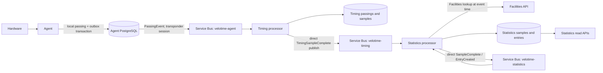

# Agent → Timing → Statistics: replay, ordering, and messaging options

## Executive summary

The pipeline uses Azure Service Bus through SlimMessageBus. The agent has a transactional PostgreSQL outbox and deduplicates locally persisted passings by their hardware-facing ID, but that ID is not included in the published passing. Timing and Statistics processors save derived data and publish separately, and important downstream paths are not replay-idempotent.[^agent-contract][^agent-publish][^timing-handler][^stats-handler]

The most urgent correctness issue is not the choice of message-bus library: a late passing inserted between two already-sampled passings can cause Timing to throw on every retry, and duplicate deliveries can create duplicate Statistics samples and results.[^timing-samples][^stats-handler][^stats-service] Sessions are configured per transponder, but they do not supply a domain sequence or correct event-time order; the exact deployed broker and client retry behavior was not verified.[^topology][^ordering]

Recommend first retaining SlimMessageBus and Azure Service Bus while introducing stable event identity, transactional inbox/outbox boundaries, a defined late-data correction model, and a controlled, versioned rebuild process. Consider a retained streaming log or an event store only if the required replay horizon, independent consumer reprocessing, throughput, or audit requirements justify that additional infrastructure. The alternatives described below are design options, not a feature or pricing evaluation verified against vendor documentation.

## Scope and key repository

Research was conducted on 2026-11-25 against commit
[`8068a51650ad85734781c1413391f5e1cee379a5`](https://github.com/asbjorjo/VeloTimer/tree/8068a51650ad85734781c1413391f5e1cee379a5).
It is a historical snapshot: later implementation changes may invalidate its
findings. Research covered local source and tests only; no tests, live broker
inspection, internet research, or production-data inspection were performed.

| Repository | Role |
|---|---|
| [asbjorjo/VeloTimer](https://github.com/asbjorjo/VeloTimer) | Agent contracts and publishing, Timing and Statistics processors and databases, Service Bus topology and deployment configuration.[^topology][^agent-publish] |



The diagram omits ownership, configuration, layout/status, and validity messages; these have separate routes and, in some cases, separate outbox implementations.[^topology][^other-outbox]

## Current implementation

### Agent: durable enqueue, but incomplete identity downstream

`Passing` has a required local `Id`; `MessagingService` inserts passings with conflict handling and publishes only newly inserted IDs in the same transaction as the agent outbox. The mapper drops `Id` when creating the event. Configuration events do not use that passing-ID deduplication.[^agent-model][^agent-publish]

The current payload is:

```csharp
public record PassingEvent(
    DateTime Time, string TransponderType, string TransponderId, string LoopId)
{
    public bool LowBattery { get; init; }
    public bool LowStrength { get; init; }
    public bool LowHits { get; init; }
}
```

It has no stable event ID, source passing ID, schema version, or sequence. The agent supplies an `AgentId` header and uses `{TransponderType}_{TransponderId}` as the passing session key. Agent outbox configuration uses `MaintainSequence`, a batch size of one, effectively unlimited attempts, and configured cleanup at three days. Its tests demonstrate that an oldest failing event can block later delivery. The exact library cleanup eligibility was not verified.[^agent-contract][^agent-bus][^agent-tests]

The outbox makes the database write and enqueue atomic, not the broker send and dispatch-completion record. A crash after broker acceptance but before marking dispatch complete can therefore cause a resend; downstream consumers must tolerate duplicates. An event time is not a unique identifier.[^agent-publish][^agent-bus]

### Timing: persistence and publication are separate

The handler registers a passing, registers a sample, publishes `PassingSaved` and, if applicable, `TimingSampleComplete`, then updates last-seen. Those writes and sends are not enclosed in a single processor transaction and outbox. On a retry, an existing passing and sample can be returned and the messages published again. If a failed message is never successfully redelivered, the code alone does not establish that the missing publication will be repaired.[^timing-handler][^timing-samples]

Passings have a database unique index on `(TransponderId, Time, TimingPointId)` and samples on `(StartId, EndId)`. The passing lookup returns the first stored version even if warning flags differ; a concurrent read-before-insert race can still produce a database uniqueness error. Neither outgoing timing contract carries an event or sample ID.[^timing-passing][^timing-schema][^timing-contract]

The key outgoing definition is:

```csharp
public record TimingSampleComplete(
    DateTime TimeStart, DateTime TimeEnd,
    Guid TimingPointStart, Guid TimingPointEnd, Guid TransponderId);
```

The actual predecessor query uses the same transponder **and installation**, selecting a strictly earlier `Time`. Equal timestamps are not ordered by a tie-breaker; the session key is instead based on the transponder and does not include installation.[^timing-samples][^ordering]

### Statistics: duplicate-sensitive projections

On each `TimingSampleComplete`, the handler looks up Facilities information, inserts a new Statistics `Sample`, saves, then publishes `SampleComplete`. There is no existing-row check or unique constraint on those samples. A redelivery can therefore insert another sample, potentially using changed Facilities data.[^stats-handler][^stats-schema]

`SampleComplete` processing creates entries in a transaction protected by a per-transponder advisory lock, but publishes `EntryCreated` after committing. Required-point and course-layout paths have replay checks; the legacy fixed Simple path does not. Multi-entry replay protection is conditional on its parent definition. Locks serialize participating writers but are not a durable processed-message record.[^stats-service][^stats-lock][^stats-attempts]

These are complete current Statistics processor event definitions:

```csharp
public record EntryCreated(
    Guid TransponderId, DateTime TimeStart, DateTime TimeEnd,
    Guid StatisticsItemId, Guid ConfigItemId);

public record SampleComplete(
    Guid TransponderId, DateTime TimeStart, DateTime TimeEnd,
    Guid CoursePointStart, Guid CoursePointEnd, double Distance);
```

Neither carries an event ID. Read APIs compute results from entries: duplicate rows are visible in listings and inflate lap counts and summed distance; best-result selection may be unaffected by identical duplicates. Duplicate parent entries can also distort Multi calculations.[^stats-contract][^stats-reads][^stats-service]

### Broker and operational configuration

The deployed configuration declares Service Bus topics and filtered subscriptions; the passing and Statistics subscriptions require sessions. Producers set session IDs and processors enable session consumers. Other agent infrastructure events use a non-session subscription. The topology reconciler supports optional duplicate detection, lock duration, delivery count, TTL, and expiration dead-letter settings, but the shipped topology does not specify those values. Existing deployed entities and broker defaults were not inspected, so effective retention, retry, and dead-letter behavior are unknown.[^topology][^broker-settings]

Do not treat sessions as event-time ordering, a global total order, cross-database atomicity, or a substitute for application deduplication. The precise Service Bus/SlimMessageBus session and redelivery semantics, including concurrency and completion behavior, require an integration test and review of the deployed settings.[^ordering][^broker-settings]

## Failure examples

### Late passing between two existing passings

1. Timing receives P1 at `t=0`, then P3 at `t=20`, creating sample P1→P3.
2. P2 at `t=10` arrives. Timing persists P2 and finds P1 as its predecessor.
3. The sample lookup finds P1→P3 because it already starts at P1, but that sample does not end at P2. The handler throws a mismatch.
4. On another attempt the persisted P2 is found again and the same mismatch remains. The code does not replace P1→P3 with P1→P2 and P2→P3.[^timing-samples]

This is inferred directly from the code; no matching end-to-end test was found. Delivery order is not necessarily event-time order: agent buffering, retries, independent agents, clock differences, and deliberate replay can produce late events even if a broker serializes a session.

### Redelivery after a Statistics commit

1. Statistics inserts sample S1 and commits.
2. The subsequent `SampleComplete` send fails or the process stops before successful processing is recorded.
3. If the broker redelivers, the handler inserts S2 for the same incoming timing event; there is no sample uniqueness guard.
4. A replay of the fixed Simple entry path can create another result. Hall-of-fame lap counts and distance can then be inflated.[^stats-handler][^stats-schema][^stats-service][^stats-reads]

These are possible failure windows, not a claim that duplicates already exist in production. The real broker retry and dead-letter behavior remains to be verified.

### Late result and dependent Multi result

For a two-lap Multi definition, late arrival of an earlier Simple result can invalidate an existing Multi window through revalidation, but the processing of that earlier result only builds windows ending at or before it. It need not recreate a missing valid later-ending window. Existing revalidation updates validity; it is not a general projection rebuild.[^stats-service][^revalidation]

## How to handle replays

First decide what “replay” means. These operations have different identities and safety requirements:

| Operation | Purpose | Required behavior |
|---|---|---|
| Retry/redelivery | Recover a transient failure | Same logical event ID; consumer applies its effects at most once while still completing the message. |
| Targeted repair | Correct a known range, source, or projection | Explicit job, affected keys/range, revision and auditable correction or recomputation. |
| Projection rebuild | Regenerate a read model after a code/schema change | Isolated generation or target, checkpoints, verification, then controlled cutover. |
| Historical reproduction | Reproduce the result as it was known at a past time | Immutable events and the relevant historical definition, ownership, layout, and lookup evidence. |

### 1. Establish an authoritative replay source

The agent passing table and Timing passing/sample tables contain useful operational facts, but neither a general replay tool nor a complete event-sourced history was found. Agent and Timing outbox cleanup is configured, so an outbox is not a durable long-term audit log. Statistics and Facilities have outbox configurations with cleanup disabled, but their documentation does not make those rows an automatic replay system. Confirm actual retention and cleanup eligibility before relying on any table.[^agent-bus][^other-outbox][^rebuild]

Choose and document the authoritative input per projection:

* **Timing rebuild:** retained source passings with stable source identities, event time, agent/installation identity, flags, and a deterministic tie-breaker.
* **Statistics rebuild:** corrected, versioned Timing sample facts plus the Facilities and definition evidence required by the desired semantics.
* **Ownership and validity:** distinguish re-evaluating current state from reconstructing prior historical state; these are not interchangeable.

Statistics persists some distance/layout evidence on samples, but definitions and Facilities layouts can change; ownership periods can be edited. A replay against current lookups does not necessarily reproduce original results. Required-point classification deliberately freezes its original evidence, so changing that behavior is a product decision, not an incidental replay fix.[^history][^stats-attempts]

### 2. Add stable identities and durable consumer idempotency

Introduce versioned contracts containing at least `EventId`, event type/version, UTC occurrence time, source identity, and correlation/causation information. For passings, carry the stable source passing ID and namespace it by agent/source as necessary; decide explicitly what happens if a device reuses its IDs. For derived samples and corrections, define stable logical identity plus revision and causation. Avoid treating timestamp tuples as universally unique without proving the domain invariant.[^agent-model][^timing-contract]

Within each consumer's database transaction, record `(consumer or projection, event ID)` in an inbox with a unique constraint, apply business changes, and enqueue outgoing events in the same transaction. A duplicate must leave no extra business effect. The inbox insert, domain writes and outbox insert must commit or roll back together. Confirm the outbox and inbox use the same service-owned database and transaction.

Use the existing versioned `EventId`/transport `MessageId` and PostgreSQL outbox precedents as starting points. Transport-level duplicate detection, if enabled, is an optimization with broker-specific scope and retention, not a replacement for durable consumer idempotency.[^other-outbox][^broker-settings]

An intentional rebuild needs a separate projection generation or replay namespace: otherwise the live consumer's inbox correctly suppresses the same IDs. Preserve the logical source event ID for audit, but use explicitly designed delivery/replay identity where broker duplicate detection might suppress a deliberately resent message. Do not generate a new logical event ID on each retry.

### 3. Build and operate replays deliberately

Implement a durable job with selection by time and source/partition, a fixed input boundary, deterministic ordering, checkpoint, failure visibility, rate limits, dry-run, and authorization. Prefer building a shadow generation and validating counts, identity uniqueness, representative race results and aggregate deltas before cutover. Define how to catch up events arriving during the build, coordinate a watermark/cutover, and roll back. Never reset live dispatcher rows as a replay mechanism without a specifically designed procedure.[^rebuild]

For narrow repairs, publish versioned correction/supersession events or recompute affected ranges and dependencies. Carry forward manual invalidation and ownership semantics deliberately; a bulk rebuild must not silently erase operator decisions. Keep old and new consumers/contracts compatible during staged deployment; route new message names through topology filters before switching publishers.[^history][^topology]

## How to handle out-of-order events

1. **Define the ordering domain.** For Timing, the current predecessor is scoped to `(installation, transponder)`, whereas transport sessions use transponder keys. Specify whether the domain stream should use that same composite key, and how hardware IDs map across agents. A session can reduce concurrency for a key but cannot sort by event time.[^ordering]
2. **Add a deterministic order.** Use source sequence where available, and define UTC event time, stable ID, and a documented tie policy. A sequence from one source does not establish order across independent sources; define a merge rule and account for clock uncertainty. Equal-time passings from distinct loops must not depend on database row ordering.[^ordering]
3. **Choose a late-data policy.** Options include buffering until an event-time watermark, accepting provisional results and correcting them, or rejecting/quarantining beyond a documented bound. The acceptable lateness, clock-skew assumptions, and latency are product/operations decisions. Buffering only reduces late arrivals; it cannot eliminate them without an unbounded wait.
4. **Reconcile the affected interval transactionally.** Under a per-domain-key lock or optimistic version check, locate predecessor and successor. For an insertion between P1 and P3, supersede P1→P3 and create P1→P2 and P2→P3, with stable IDs and monotonic revisions. Atomically persist the revised graph and its correction events. Handle first/last and equal-time cases explicitly.[^timing-samples]
5. **Propagate corrections.** Statistics needs a defined way to invalidate/supersede old samples and entries and recompute every affected downstream window, including later Multi windows. Use revision checks to prevent delayed old messages restoring stale projections. Decide whether frozen required-point results remain frozen or are recomputed by a separately authorized correction workflow.[^stats-attempts][^revalidation]
6. **Contain poison messages.** Configure and monitor delivery attempts, dead-letter queues, oldest pending outbox age and blocked partitions; provide inspected, auditable re-drive. Do not silently skip a bad event if later processing would violate ordering. An indefinitely retrying single-item outbox has head-of-line blocking risk.[^agent-tests][^broker-settings]

## Is SlimMessageBus a limiting factor? What are the options?

**Assessment:** there is no evidence in this repository that SlimMessageBus prevents the core fixes. It already supplies the project's PostgreSQL outbox integration; the application and broker configuration determine event identity, transaction boundaries, retention, session keys, correction semantics and consumer idempotency. Replacing the library alone would not fix the demonstrated late-passing or duplicate-projection behavior.[^agent-bus][^other-outbox][^timing-samples][^stats-handler]

| Option | Suitable when | Main trade-offs and checks |
|---|---|---|
| Keep SlimMessageBus + Azure Service Bus | Current operational model and throughput are acceptable; targeted repair or database-backed rebuild suffices | Lowest migration scope. Implement inbox/outbox and replay sources; verify actual session, lock, duplicate-detection, TTL and DLQ semantics in the deployed namespace. |
| Keep Azure Service Bus, use the Azure SDK directly | More explicit control of transport settlement, sessions or diagnostics is worth owning more plumbing | More custom code and integration tests; retained-history and domain-correction needs still exist. Exact feature gaps must be established before migration. |
| Replace the application messaging framework, retaining Service Bus | Another framework provides demonstrably better outbox/inbox, observability or operations for this team | Evaluate actual provider support, transaction coupling, licensing, upgrades and migration interoperability. The repository does not establish a feature gap or benchmark alternatives. |
| Add a retained streaming platform, e.g. Kafka, Azure Event Hubs, or Pulsar | Multiple independent projections need replay over a defined retention horizon and partitioned log consumption | Introduces offset/retention management, partition-key design, operations and a migration/dual-publish strategy. Verify each product's actual semantics and current capabilities; a stream is not automatically an event store, a database transaction, or correct event-time processing. |
| Add an application-owned event store / append-only journal | Durable audit, reproducible historical projections, event versioning and explicit correction history are core requirements | Requires versioned contracts, event retention, evolving schemas, concurrency control, storage/operations, and a reliable append boundary. Historical reconstruction also needs reference-data history. |

Azure Service Bus and the local package choices are evidenced in the repository; the alternatives above are conceptual candidates, not locally installed components or externally verified product comparisons.[^packages] Test actual cost, throughput, retention, deployment, support and operational fit before a decision.

## Recommended implementation sequence

1. **Measure and specify:** inspect deployed topology and queue/DLQ state; measure duplicate samples/entries and blocked outbox age; agree on replay horizon, acceptable latency/lateness, equal-time ordering, retention, audit requirements and correction rules.
2. **Contract and compatibility:** define versioned event envelope, stable passing/sample IDs, source key, causation and revision; roll out consumers and filters before producers. Preserve old message handling during migration.
3. **Delivery correctness:** make Timing passing/sample changes and outgoing events atomic; make Statistics sample/entry changes and their outgoing events atomic; add transactionally coupled inbox deduplication and appropriate domain constraints. Cover crash boundaries and concurrent replicas.
4. **Late-data correctness:** implement and test predecessor/successor reconciliation, supersession, propagation, dependent Multi recomputation and the chosen frozen-evidence policy.
5. **Controlled repair and rebuild:** create a checkpointed shadow projection workflow with a fixed input boundary and catch-up/cutover; preserve auditable manual decisions and verify results.
6. **Re-evaluate infrastructure:** benchmark actual load and replay needs against the existing broker; select a streaming or journal solution only if the measured requirements call for it.

The existing ownership and threshold flows show transactional outbox and durable job patterns worth reusing; their correctness must still be validated for the new transactions and host concurrency.[^other-outbox][^revalidation]

## Validation plan

* PostgreSQL integration tests: duplicate and concurrent delivery, inbox/outbox atomic commit and rollback, process restart at each write/send boundary, and safe retry after a transient uniqueness conflict.
* Ordering tests: P1/P3/P2; P3/P1; repeated and equal-time passings on different loops; cross-agent and cross-installation cases; concurrent writers; late data after a result is already visible.
* Projection tests: duplicate `TimingSampleComplete` and `SampleComplete`; fixed Simple, required/layout and Multi items; late entry requiring a later Multi window; correction/retraction applied twice and out of order; manual invalidation preservation.
* Real Service Bus integration: sessions, cross-host behavior, lock renewal, abandon/redelivery, DLQ and re-drive, filter routing, outbox restart, configured duplicate detection, and intentional replay identity.
* Rebuild tests: reproducibility with versioned reference data; explicit current-state versus as-known-at-the-time behavior; fixed input boundary, catch-up, checkpoint/restart and cutover comparison.

The repository includes agent outbox, passing-idempotency, some out-of-order, required-point replay and validity tests; these do not establish end-to-end broker semantics or cover all failure examples above.[^agent-tests][^existing-tests]

## Confidence assessment

* **High:** current code paths, contract fields, schema indexes, absence of an outbox on the two processor paths, and conditional replay gaps, as supported by local source and tests.
* **Moderate:** the specific failure scenarios are reasoned from code; they were not run against PostgreSQL or a live broker. The exact effect of retries and settlement depends on runtime and deployment configuration.
* **Low / unknown:** deployed Service Bus tier, entity settings, retained messages, DLQ contents, actual historical data quality, workload and clock characteristics, library internals, and suitability/cost of alternative products. No external documentation or production resources were consulted.
* **Assumptions:** source IDs can be made stable or replaced with a durable generated mapping; the team can agree on ordering and correction semantics; historical reproducibility is not assumed to be the same as recomputation under current configuration.

## Footnotes

[^agent-contract]: `src/Agent.Interface/Messages/Events.cs:3-18`; `src/Agent/Mapping/EventMappers.cs:7-21`.
[^agent-model]: `src/Agent/Model/Passing.cs:3-13`; `src/Agent/Storage/AgentDbContext.cs:18`; `src/Agent/Mapping/EventMappers.cs:7-21`.
[^agent-publish]: `src/Agent/Service/MessagingService.cs:48-59`, `:113-115`, `:147-175`.
[^agent-bus]: `src/Agent/HostingExtensions.cs:77-105`, `:132-149`; `src/Agent/MessageBusOptions.cs:13`.
[^agent-tests]: `src/VeloTime.Workers.Test/AgentOutboxTests.cs:81-147`, `:166-218`, `:247-311`, `:394-408`.
[^timing-handler]: `src/Module.Timing.Processor/Handlers/PassingObservedHandler.cs:21-63`; `src/Module.Timing.Processor/HostingExtensions.cs:31-81`.
[^timing-passing]: `src/Module.Timing/Service/AgentService.cs:20-71`.
[^timing-samples]: `src/Module.Timing/Service/AgentService.cs:73-155`; `src/Module.Timing/Storage/TimingDbContext.cs:51-62`.
[^timing-schema]: `src/Module.Timing/Storage/TimingDbContext.cs:18-42`, `:51-62`.
[^timing-contract]: `src/Module.Timing.Interface/Messages/PassingSaved.cs:3`; `src/Module.Timing.Interface/Messages/TimingSampleComplete.cs:3`.
[^ordering]: `src/Agent/HostingExtensions.cs:100-105`; `src/Module.Timing/Service/AgentService.cs:122-155`; `src/Module.Timing.Processor/HostingExtensions.cs:30-50`; `src/VeloTime.Module.Timing.Test/TimingServiceTests.cs:197-233`; `docs/statistics-validity-thresholds-messaging.md:42`.
[^stats-handler]: `src/Module.Statistics.Processor/Handlers/TimingSampleHandler.cs:19-63`; `src/Module.Statistics.Processor/Handlers/SampleCompleteHandler.cs:16-40`.
[^stats-schema]: `src/Module.Statistics/Storage/StatisticsDbContext.cs:25-42`, `:94-135`; `src/Module.Statistics/Storage/SampleAttemptIndexes.md`.
[^stats-service]: `src/Module.Statistics/Service/StatisticsService.cs:26-108`, `:166-262`.
[^stats-lock]: `src/Module.Statistics.Processor/Service/StatisticsOwnershipService.cs:14-25`, `:96-122`.
[^stats-attempts]: `src/Module.Statistics/Service/RequiredCoursePointAttemptReader.cs:23-50`; `src/Module.Statistics/Service/CourseLayoutLapAttemptReader.cs:137-148`; `src/VeloTime.Module.Statistics.Test/StatisticsRequiredPointsTests.cs:95-133`.
[^stats-contract]: `src/Module.Statistics.Interface/Messages/SampleComplete.cs:3-4`.
[^stats-reads]: `src/Module.Statistics.Api/Endpoints/HallOfFameEndpoints.cs:68-114`; `src/Module.Statistics.Api/Endpoints/PublicStatisticsEndpoints.cs:72-96`; `src/Module.Statistics.Api/Endpoints/BestStatisticsResultsEndpoints.cs:26-49`.
[^revalidation]: `src/Module.Statistics.Processor/Service/StatisticsRevalidationService.cs:76-186`; `src/VeloTime.Workers.Test/StatisticsValidityPostgreSqlTests.cs:401`.
[^topology]: `src/MessageBus.Topology/topology.json:3-56`; `charts/velotime/values.yaml:71-107`; `src/Module.Statistics.Processor/HostingExtensions.cs:42-103`.
[^broker-settings]: `src/MessageBus.Topology/MessageBusTopologyOptions.cs:3-6`, `:22`; `src/MessageBus.Topology/MessageBusTopologyReconciler.cs:34-35`, `:56-61`, `:91-107`, `:123-129`; `charts/velotime/values.yaml:71-107`.
[^other-outbox]: `src/Module.Statistics.Interface/Messages/StatisticsValidityThresholdsChangedV1.cs:12-15`; `src/Module.Statistics.Api/MessagingExtensions.cs:40-47`; `src/Module.Statistics/Storage/StatisticsOutboxExtensions.cs:14-28`; `src/Module.Facilities.Api/MessagingExtensions.cs:24-34`; `src/Module.Timing.Api/MessagingExtensions.cs:33-56`; `src/Module.Timing/Service/TransponderOwnershipService.cs:134-162`; `src/Module.Statistics.Api/StatisticsThresholdEnqueue.cs:21-27`.
[^rebuild]: `src/Module.Statistics/Storage/OutboxPersistence.md:53-58`; `src/Module.Statistics/Storage/LapDistanceRollout.md:5-15`, `:37`; `src/Module.Statistics.Processor/Service/StatisticsRevalidationService.cs:116-177`.
[^history]: `src/Module.Statistics/Model/Sample.cs:3-18`; `src/Module.Statistics/Model/StatisticsEntry.cs:24-51`; `src/Module.Statistics/Storage/ValidityPersistence.md:24-28`, `:83-85`; `src/Module.Facilities/Model/CourseLayout.cs:3-49`; `src/Module.Facilities.Api/Endpoints/FacilityAdministrationEndpoints.cs:112-199`; `src/Module.Timing/Service/TransponderOwnershipService.cs:53-62`, `:107-130`.
[^packages]: `Directory.Packages.props:14`, `:29`, `:79-81`; `src/AppHost/AppHost.cs:41`.
[^existing-tests]: `src/VeloTime.Module.Timing.Test/TimingServiceTests.cs:183-285`; `src/VeloTime.Workers.Test/WorkerHandlerTests.cs:242-315`; `src/VeloTime.Workers.Test/StatisticsRequiredPointsProcessingTests.cs:20`; `src/VeloTime.Workers.Test/StatisticsValidityPostgreSqlTests.cs:401`.
