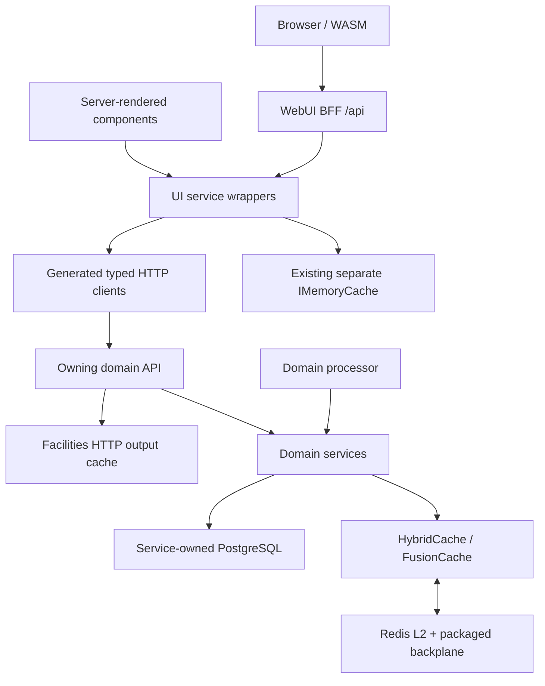

# Hybrid cache research and implementation handoff

Research snapshot: **2026-10-31**. Status: **phase-two eligible UI caching implemented and targeted validation passed**.

## Executive summary

VeloTimer already has the infrastructure to cache lookup data across services: the `HybridCache` abstraction is backed by FusionCache, Redis distributed storage and FusionCache's packaged Redis backplane.[^1] HTTP output caching is a separate subsystem, currently used by Facilities, with separate eviction calls.[^2] Phase two now adds typed WebUI preference and lookup snapshots with explicit 30-second local and distributed expirations. Public statistics discovery/results retain their live visibility checks and `no-store` contract; no blanket response caching was introduced.[^7]

## Phase-two implementation update

The WebUI implementation is in place; functional/isolation tests and production Redis validation **passed**:

- Persisted display and language preferences now share one server cache owner across BFF, localization, and server-interactive reads/writes. Successful writes strictly evict only that issuer/subject's preference-kind tag; BFF no-store, antiforgery, upstream validation bodies, anonymous/browser-language fallback, and language-outage signaling remain at their original boundaries.
- Time-zone catalogue snapshots require an authenticated issuer/subject/session and vary by current UI culture. Effective browser locale/time zone remains session presentation state, not shared cache data. MainLayout resets/cancels identity-bound preference state on authentication transitions.
- Public facilities/layouts and facility/course-point names use separate typed, public-safe snapshots and `Facilities.Relationships` invalidation. Admin facility/layout reference snapshots use a separate caller-scoped key and check `Administration.References`; statistics definition snapshots use caller-scoped keys and check `Statistics.Admin`.
- Current username is cached only in the personal namespace. Installation GETs, timing configuration, `LastSeen`, status/telemetry, public statistics membership/results, owner/account/security data, permissions, and rendered/HTTP responses remain live or uncached.
- UI facility/layout/timing-link writes invalidate the Facilities dependency after success. Statistics definition writes invalidate the UI definition dependency after success. Invalidation uses the existing strict operation and a bounded cancellation-independent token; an invalidation failure remains visible as an error.
- Every new cache access supplies both `Expiration` and `LocalCacheExpiration` as 30 seconds; no fail-safe stale serving or module-default change was added. This is entry retention, not an unconditional end-to-end freshness guarantee: Facilities output caching can refill an older snapshot, and late factories can refill an older value. Cross-host behavior was measured separately from entry expiry.

### Verification and remaining limits

- Full [Platform test project](../../src/VeloTime.Platform.Test/VeloTime.Platform.Test.csproj), with actual Redis and isolated PostgreSQL: **439 passed, 0 failed, 2 opt-in browser harnesses skipped**.
- [WebUiRedisCacheTests](../../src/VeloTime.Platform.Test/WebUiRedisCacheTests.cs): **10 passed**, exercising production registration, typed HTTP clients and real Facilities API mutations. Actual local and cold-host distributed values remained warm at 27 seconds and refreshed after the 30-second lifetime; observed expiry refresh was 31.26 seconds in that run.
- [FacilitiesOutputCacheReplicaTests](../../src/Module.Facilities.Api.Test/FacilitiesOutputCacheReplicaTests.cs): **1 passed** with actual Redis. Differently shaped UI snapshot tag propagation was observed at 9.2 ms; the PostgreSQL-backed mutation reached a remote UI factory after 15.3 ms and the nested output response converged after 31.35 seconds. These are test observations, not production SLAs or unconditional freshness bounds.
- WebUI Release build: **passed, 0 errors**, with existing dependency advisory warnings. `git diff --check` passed. The README registration-dates JavaScript tests also passed (4 tests).
- [WebUiCacheRegressionTests](../../src/VeloTime.Platform.Test/WebUiCacheRegressionTests.cs) cover issuer/subject/session and personal/admin isolation, missing claims, authorization on warm hits, defensive copies, failures and malformed-response retries. Preference tests cover BFF/server parity, no-store/antiforgery/validation behavior and authentication/retry/save races.
- Cache callbacks use an independently owned async DI scope and a cloned keyed principal through the existing Duende user accessor. Normal concurrent misses share a factory. Cancellation/disposal of the initiating caller may cancel that first attempt and cause one bounded retry; tests verify the second caller succeeds under the correct identity without using disposed initiating-scope clients.
- Nested layout snapshots use parameterless/init payloads compatible with the existing `ReferenceHandler.Preserve` serializer; cold Redis roundtrips cover public/admin shapes. Global serializer and cache defaults remain unchanged.

Interactive browser/WASM execution and solution-wide build/tests were **not run**. Server/BFF transport and component tests cover their changed contracts, but do not substitute for browser validation. No immediate cross-replica refresh guarantee is introduced; unknown durable outcomes after transport failure and changes bypassing WebUI converge through bounded entry expiry unless already covered by an owner tag.

Timing installation/timing-point configuration caching is explicitly excluded from this eligible slice: current GET responses are not protected configuration-only contracts and contain live `LastSeen`. They remain freshly fetched rather than caching the complete payload or introducing a protected API contract in this change. Separately cacheable facility-name composition is covered. A future stable-only timing cache needs its own approved read/authorization contract.

The read-only review confirmed no personal/admin or warm-cache authorization defect in inspected paths; its scope note is addressed by the explicit timing exclusion above. Review was implementation/test based, not an independently executed build/test run. The remaining sections retain the original research snapshot and proposed broader validation matrix; this update is the current implementation/verification status.

### Post-deployment fix: validated issuer missing from sign-in tickets

After deployment, signed-in `GET /api/profile/preferences/display` returned 403. Root cause: the WebUI cache keys personal data on the validated `iss`/`sub` claims and deliberately refuses (403) when either is missing, but ASP.NET Core 10.0.12 `OpenIdConnectOptions` installs a default `ClaimActions.DeleteClaim("iss")`. Those actions run after the id_token is validated and `TokenValidated` fires, but before the ticket is persisted. Persisted principals therefore kept `sub`/`sid` but never `iss`. `sid` is not deleted by default.

[CookieOidcServiceCollectionExtensions.cs](../../src/WebUI.Mud/CookieOidcServiceCollectionExtensions.cs) now removes only that default `iss` delete action. No action maps `iss` from userinfo, so the persisted `iss` is the one the token handler validated; a userinfo `iss` value is ignored. Cache issuer validation is unchanged; there is no subject-only or authority-claim fallback and no unvalidated-token parsing. Sessions created before this fix lack `iss` and keep getting 403 on personal cached reads. Those users must sign out and sign in again after deployment; the token store is keyed by `sub`/`sid` and is unaffected.

## Research snapshot provenance

The original research was recorded from a shared checkout and its source references/line numbers are historical, not pinned to a verified commit SHA. This implementation was subsequently performed only in the requested isolated worktree on `fix/ui-hybrid-cache-phase-two`; no shared checkout was edited and no commit was created. Validation status is summarized above.

## 1. Keep the existing backplane

**No custom Redis backplane is recommended.**

The current [AddModuleCache registration](../../src/Module.Common/HostingExtensions.cs) (lines 76-119) wires:

```text
HybridCache abstraction
    -> FusionCache
        -> process-local memory
        -> Redis distributed cache
        -> packaged FusionCache RedisBackplane
```

It uses `AddRedisDistributedCache("cache")`, a System.Text.Json serializer with `ReferenceHandler.Preserve`, `WithRegisteredDistributedCache()`, `WithBackplane(...)`, and `AsHybridCache()`. Configured defaults are five minutes for entry duration and one minute for memory duration. These are configuration values, not verified end-to-end freshness guarantees.[^1]

FusionCache, backplane, serializer and telemetry packages were pinned to **2.6.0**. No Redis-specific ASP.NET Core output-caching package was found in the central manifest.[^8]

The proposed work is **application-level invalidation**: execute existing key/tag eviction APIs after writes, cover every affected identity and let FusionCache handle cross-instance coordination. Cross-process key/tag propagation still requires tests using the production registration.[^1][^9]

## 2. Architecture: shared infrastructure, separate layers



Each host has its own DI container and process-local cache state. Sharing Redis does not make API, processor and WebUI caches one in-memory instance. Nor does it make HTTP output-cache entries part of HybridCache.[^1][^2][^10]

| Surface | Current caching |
|---|---|
| Facilities | Relationship lookups tagged `Facilities.Relationships`; five separately tagged HTTP output routes.[^2][^11] |
| Timing | Installation, timing-point, transponder and last-passing lookups, mainly exact-key invalidation.[^4][^12] |
| Statistics | Configuration lookups, not cached public result pages.[^5][^7] |
| Profiles API | No caching found in inspected preference endpoints/composition.[^13] |
| WebUI | Server HybridCache infrastructure registered; phase-two implementation now uses audience/identity-specific typed snapshots for the approved preference and lookup surfaces.[^1][^3] |

Existing domain cache queries often return EF entities/collections without `AsNoTracking()` projection. This is a mutable-object/DbContext concern, not a reproduced aliasing bug. For **new read-only caches**, prefer compact immutable snapshots; keep database factories in the owning service. Do not mechanically refactor ingestion caches or cached entities used for writes without behavior-specific tests.[^11][^12][^14]

## 3. Invalidation findings

### Agent layout updates

[InstallationLayoutHandler](../../src/Module.Timing.Processor/Handlers/InstallationLayoutHandler.cs) (lines 16-61) obtains installation/point entities through lookup/create services, mutates them and ends with `SaveChangesAsync` without explicit eviction after the final save.[^6]

**Recommendation:** invalidate all affected installation and timing-point lookup forms after commit. Centralize key/dependency construction in the owning Timing service. Exact stale values and durations remain runtime-unverified.

### Timing point rename

[TimingAdministrationService](../../src/Module.Timing/Service/TimingAdministrationService.cs) removes the old composite point key before changing `SystemId`, then removes the new key after saving (lines 81 and 91).[^4]

A concurrent reader can potentially refill the old key from pre-rename DB state between the first removal and commit; the old key then lacks a second post-commit eviction.[^4]

**Recommendation:** capture old/new identities and evict their union after commit, including point-ID and installation dependencies. Also test factories that began before commit but complete after eviction; moving removals alone is not proof against every late refill.

### Statistics configuration relink

[StatisticsDefinitionEndpoints](../../src/Module.Statistics.Api/Endpoints/StatisticsDefinitionEndpoints.cs) follows the same old-before/new-after pattern when changing end-course-point or parent configuration. Affected keys include `StatisticsItemConfig_End_{coursePointId}` and `MultiStatisticsItemConfig_{parentConfigId}`.[^5]

**Recommendation:** preserve pre-mutation dependency identities, union them with post-mutation dependencies and evict after commit.

### Expanded caching requires expanded writer coverage

Facilities already evicts relationship dependencies on edits, but its list/detail reads are not uniformly cached and create/delete paths do not uniformly perform those cache calls. Adding lookup/list/UI caches expands the mutation coverage required.[^2][^15]

Do not silently swallow eviction failures or let request cancellation erase an eviction obligation after a durable write.

## 4. API output caching

Facilities registers a named `"Default"` policy with a 30-second expiry, but the researched routes use inline tag policies instead:

```csharp
.CacheOutput(policy => policy.Tag("Facilities.Relationships"))
```

The named expiry is not explicitly applied to those routes. The effective framework default expiry was not verified locally; do not assume it is 30 seconds.[^2]

**Proposed policy:**

- Apply an explicitly named, tagged policy with explicit expiry.
- Initially preserve the intended 30-second duration rather than extending retention.
- Opt in eligible public, non-personalized lookups only.
- Test all response-changing route/query/header/language inputs and status eligibility.
- Preserve authorization safeguards; do not force caching of private responses.
- Define freshness across nested data/output caches: a short output TTL can still be refilled from older application data.

### Storage decision

Continue the existing dual eviction:

```csharp
await cache.RemoveByTagAsync("Facilities.Relationships", cancellationToken);
await output.EvictByTagAsync("Facilities.Relationships", cancellationToken);
```

These are separate operations on separate stores.[^2]

For multiple API replicas, evaluate a supported Redis-backed output-cache store before writing a custom `IOutputCacheStore` adapter. Confirm package/API availability and distributed tag eviction semantics first. Even when both stores use Redis, one subsystem's eviction does not automatically remove the other's entries.[^1][^2][^8]

This is a response-storage concern, **not a reason to replace FusionCache's backplane**.

## 5. UI lookup caching

[WebUI StatisticsService](../../src/WebUI.Mud/Services/StatisticsService.cs) injects `IMemoryCache` and caches course-point responses by bare GUID (lines 124-144), without configured expiry or a discovered invalidation hook. Facilities tag eviction does not directly evict that separate cache.[^3]

**Recommended replacement:**

- Use the already registered server HybridCache.
- Cache compact course-point name/snapshot values.
- Use versioned, value-shape-specific keys, for example:

```text
velotime:webui:facilities:coursepoint-name:v1:{coursePointId}
velotime:facilities:coursepoint-snapshot:v1:{coursePointId}
```

- Attach `Facilities.Relationships` initially.
- Explicitly validate expiry options through the installed adapter.
- Do not extend default retention until Facilities-to-WebUI tag propagation is proven.
- Fetch through the Facilities client; never query another service's DB.
- Do not reuse an EF-entity key for a DTO/string. Sharing stored values requires agreed types, serialization and versions; sharing dependency tags with different typed keys is the safer first step.[^1][^3][^11][^16]

Keep cache logic out of generated client output. Server and WASM paths use common UI service interfaces with different transports; preserve their behavior.[^16]

Components currently reload after successful saves/deletes or offer manual refresh. Keep that flow, but test that lower-layer caches do not defeat the reload. Strict cross-replica read-your-writes requires an explicit consistency mechanism, not an assumption of instantaneous backplane delivery.[^17]

Retain the BFF's `no-store` filter. Statistics routes are mapped on the `/api` group; `AllowAnonymous()` changes authorization but does not remove filter inheritance. Thus legacy best-results/samples BFF routes also inherit `no-store`.[^18]

For any future private server-side cache, authorize each read and partition by relevant identity/tenant/representation inputs. Existing token storage provides namespaced subject/session keys and protected-payload prior art; it is not permission to cache private responses indiscriminately.[^19]

## 6. Statistics visibility safeguards

The [public statistics contract](../../api/statistics-public-contract.md) requires:

- Current `IsPublic` membership on every request.
- `no-store` for public discovery/results and BFF responses.
- Fixed 25-row pages, 26-row lookahead and exclusive keyset cursors.
- Required facility/item/configuration filters, with optional name, duration, speed and cursor/direction inputs.
- No client-selected page size/offset/count.[^7]

**Do not cache complete public discovery/result payloads under the current contract.** The restriction follows from live visibility requirements, not from HTTP `no-store` alone. Stable facility/course-point metadata can be cached separately without caching result membership.

The legacy module best-results query also checks `StatsProfile.IsPublic`, though it lacks an explicit module-level `no-store` assignment. Its BFF route inherits `no-store`; absence of a module header is not approval for stale visibility.[^18][^20]

The legacy sample query includes transponder identifiers and lacks a local public-profile/ownership predicate. Effective module authorization was not conclusively established. Exclude it from new response-cache eligibility until that boundary is clarified.[^21]

## 7. Durability and consistency

Direct eviction after commit leaves a failure window if a process crashes or Redis/output eviction fails.

**Optional later improvement:** record a service-owned invalidation work item/event transactionally, then retry existing eviction calls idempotently. This ensures eviction eventually executes; it does **not** replace the backplane.

Timing ownership writes already have an outbox and broker-outage recovery test, providing prior art. They do not make unrelated cache calls durable. Any invalidation adaptation still needs actual work-item/event design, delivery wiring, ordering, retries and failure visibility.[^22]

Ordinary business-event consumption is not proof of fan-out to every cache replica. If new cross-service contracts become necessary, agree ownership, versioning, subscriptions and replay before dependent implementations. Local Timing writer fixes do not themselves require a new cross-service contract.

## 8. Validation matrix

Domain Timing/Facilities tests use memory-only FusionCache. The inspected API factories use stock HybridCache plus distributed memory cache. Neither setup exercises the production Redis backplane; the Facilities relationship regression uses a single host.[^9]

At the original research snapshot, all following tests were **proposed, not executed**. See the phase-two verification update above for the subset now executed; remaining scenarios are not implied to be verified:

| Scenario | Required assertion |
|---|---|
| Production setup | Actual FusionCache adapter, serializer, Redis and packaged backplane |
| Cross-host exact-key eviction | Warm A/B; update through A; B reads current data within the agreed bound |
| Cross-host tag eviction | Facilities mutation evicts both API and differently typed WebUI metadata entries |
| HTTP output layer | Eviction affects output warmed on both replicas independently of HybridCache |
| Agent layout | Warm lookups, apply layout update, read current fields through another host |
| Timing rename | Old/new composite, ID and installation dependencies are correct |
| Statistics relink | Old/new grouping queries are correct |
| Late factory completion | Pause after old DB read, commit and evict, release factory; no stale refill under chosen consistency model |
| Concurrent miss | Verify factory/stampede behavior separately from late-refill testing |
| Commit succeeds, eviction fails | Observable failure and chosen recovery; include cancellation after commit |
| Restart/missed notification | Measure actual stale bound across nested caches |
| Visibility change | Identical requests around public/private toggle reflect current membership |
| Authorization | No cross-user/tenant leakage or private/public representation sharing |
| Representation variation | Every response-changing input is exercised |
| UI save/reload | Committed values appear in both server and WASM flows |
| Expiry | Measure applied policy, not merely registered named policy |

Retain existing FusionCache telemetry; add invalidation failure/latency observability. Hit rate alone is not evidence of correctness.[^1]

AppHost wires Redis `cache` to domain APIs/processors/WebUI, not Profiles API. Inspected Helm values use `cache-service:1234`, while the parent depends on Valkey without a local `fullnameOverride`. Render/DNS/port verification remains necessary; static configuration does not prove a deployed connectivity defect.[^10][^23]

## 9. Phased continuation

1. **Correct existing behavior:** recheck/fix layout invalidation, capture old/new keys, explicitly apply Facilities output policy and add regressions.
2. **WebUI phase two (implemented; validation pending):** migrate course-point caching and add the approved typed preference/lookup snapshots; prove cache isolation, write invalidation, and cross-host propagation before declaring this phase validated.
3. **Scale eligible response caches:** evaluate supported distributed output storage if deployment needs it; expand only visibility-independent lookup coverage.
4. **Strengthen recovery if required:** design durable invalidation and specify bounded staleness versus strict read-your-writes.

## Confidence and limitations

**Source-confirmed:** registration and package version; configured durations; separate dual eviction; unused named expiry at inspected routes; UI cache without configured expiry; old-before/new-after mutation ordering; missing explicit final layout-handler eviction; public visibility contract; divergent domain/API test wiring; BFF group/filter inheritance.

**Needs runtime proof:** stale-read interleavings, EF object aliasing effects, cross-application key/tag propagation, adapter option mapping, default output expiry/eligibility, outage recovery and achievable freshness bounds.

The original research used ten focused local repository investigations plus handoff/citation checks and did not execute builds, tests, or production experiments. The later implementation build is recorded above. Dependency internals, browser behavior, focused tests, and production Redis propagation remain unverified. Working-tree references are not pinned to a verified commit SHA.

## Source references

[^1]: [Module.Common/HostingExtensions.cs](../../src/Module.Common/HostingExtensions.cs), lines 76-119; [WebUI Program.cs](../../src/WebUI.Mud/Program.cs), line 76.
[^2]: [Facilities API Program.cs](../../src/Module.Facilities.Api/Program.cs), lines 22-27 and 54; [CoursePointEndpoints.cs](../../src/Module.Facilities.Api/Endpoints/CoursePointEndpoints.cs), lines 16-22; [FacilityAdministrationEndpoints.cs](../../src/Module.Facilities.Api/Endpoints/FacilityAdministrationEndpoints.cs), lines 170-203; [FacilityEndpoints.cs](../../src/Module.Facilities.Api/Endpoints/FacilityEndpoints.cs), lines 101-110.
[^3]: [WebUI StatisticsService.cs](../../src/WebUI.Mud/Services/StatisticsService.cs), lines 12-15 and 124-144; facility-name fetch at lines 104/107.
[^4]: [TimingAdministrationService.cs](../../src/Module.Timing/Service/TimingAdministrationService.cs), lines 69-115, especially 81 and 91.
[^5]: [StatisticsDefinitionEndpoints.cs](../../src/Module.Statistics.Api/Endpoints/StatisticsDefinitionEndpoints.cs), lines 129-186.
[^6]: [InstallationLayoutHandler.cs](../../src/Module.Timing.Processor/Handlers/InstallationLayoutHandler.cs), lines 16-61.
[^7]: [statistics-public-contract.md](../../api/statistics-public-contract.md), lines 40, 78, 93-136 and 157-196; [PublicStatisticsDTO.cs](../../src/Module.Statistics.Interface/Data/PublicStatisticsDTO.cs), lines 41-80; [PublicStatisticsEndpoints.cs](../../src/Module.Statistics.Api/Endpoints/PublicStatisticsEndpoints.cs), lines 15, 25 and 47.
[^8]: [Directory.Packages.props](../../Directory.Packages.props), lines 79-82 and manifest inspection.
[^9]: [TimingServiceTests.cs](../../src/VeloTime.Module.Timing.Test/TimingServiceTests.cs), lines 255-265; [FacilitiesServiceTests.cs](../../src/VeloTime.Module.Facilities.Test/FacilitiesServiceTests.cs), lines 39-44 and 84-89; [TimingApiFactory.cs](../../src/Module.Timing.Api.Test/TimingApiFactory.cs), lines 57-60; [FacilitiesApiFactory.cs](../../src/Module.Facilities.Api.Test/FacilitiesApiFactory.cs), lines 43-46; [StatisticsApiFactory.cs](../../src/Module.Statistics.Api.Test/StatisticsApiFactory.cs), lines 43-46; [FacilitiesEndpointTests.cs](../../src/Module.Facilities.Api.Test/FacilitiesEndpointTests.cs), `TimingLinkChanges_InvalidateRelationshipCaches` around line 46.
[^10]: [AppHost.cs](../../src/AppHost/AppHost.cs), lines 68-111 and 131-161.
[^11]: [FacilitiesService.cs](../../src/Module.Facilities/Service/FacilitiesService.cs), lines 24-150.
[^12]: [InstallationService.cs](../../src/Module.Timing/Service/InstallationService.cs), lines 19-152 and 187-207; [AgentService.cs](../../src/Module.Timing/Service/AgentService.cs), lines 94-133; [TransponderEndpoints.cs](../../src/Module.Timing.Api/Endpoints/TransponderEndpoints.cs), lines 135 and 151.
[^13]: [ProfilePreferenceEndpoints.cs](../../src/Module.Profiles.Api/Endpoints/ProfilePreferenceEndpoints.cs), lines 16-22 and endpoint implementations; [Profiles API Program.cs](../../src/Module.Profiles.Api/Program.cs), composition inspection.
[^14]: [StatisticsService.cs](../../src/Module.Statistics/Service/StatisticsService.cs), lines 96-119.
[^15]: [FacilityEndpoints.cs](../../src/Module.Facilities.Api/Endpoints/FacilityEndpoints.cs), lines 62-110 and create/delete paths.
[^16]: [Timing client Extensions.cs](../../src/Module.Timing.Client/Extensions.cs), lines 1-14; [Timing client project](../../src/Module.Timing.Client/VeloTime.Module.Timing.Client.csproj), lines 16-19; [FacilityService.cs](../../src/WebUI.Mud/Services/FacilityService.cs), lines 8-16; [FacilityHttpService.cs](../../src/WebUI.Mud.Client/Services/FacilityHttpService.cs), lines 1-13; [IStatisticsService.cs](../../src/WebUI.Mud.Client/Services/IStatisticsService.cs), lines 7-16.
[^17]: [TransponderManagement.razor](../../src/WebUI.Mud.Client/Components/TransponderManagement.razor), lines 187, 363, 449 and 470; [TransponderStatus.razor](../../src/WebUI.Mud.Client/Pages/TransponderStatus.razor), line 17.
[^18]: [BffEndpoints.cs](../../src/WebUI.Mud/Endpoints/BffEndpoints.cs), lines 12-56 and 94; [WebUI StatisticsEndpoints.cs](../../src/WebUI.Mud/Endpoints/StatisticsEndpoints.cs), lines 9-45.
[^19]: [ServerSideTokenStore.cs](../../src/WebUI.Mud/Authentication/ServerSideTokenStore.cs), lines 22-69; [DistributedTicketStore.cs](../../src/WebUI.Mud/Authentication/DistributedTicketStore.cs), lines 13-17.
[^20]: [BestStatisticsResultsEndpoints.cs](../../src/Module.Statistics.Api/Endpoints/BestStatisticsResultsEndpoints.cs), lines 12-27.
[^21]: [SampleEndpoint.cs](../../src/Module.Statistics.Api/Endpoints/SampleEndpoint.cs), lines 17-19, 28-29, 37 and 51.
[^22]: [Timing API MessagingExtensions.cs](../../src/Module.Timing.Api/MessagingExtensions.cs), lines 13-54; [TransponderOwnershipService.cs](../../src/Module.Timing/Service/TransponderOwnershipService.cs), save/enqueue path; [OwnershipOutboxTests.cs](../../src/Module.Timing.Api.Test/OwnershipOutboxTests.cs), lines 27-80.
[^23]: [Timing API chart values](../../charts/velotime/charts/module-timing-api/values.yaml), lines 4-6; [Parent chart values](../../charts/velotime/values.yaml), lines 9-10 and override inspection; [Chart.yaml](../../charts/velotime/Chart.yaml), dependency section; [Deployment template](../../charts/velotime-library/templates/_deployment.yaml), line 9.
