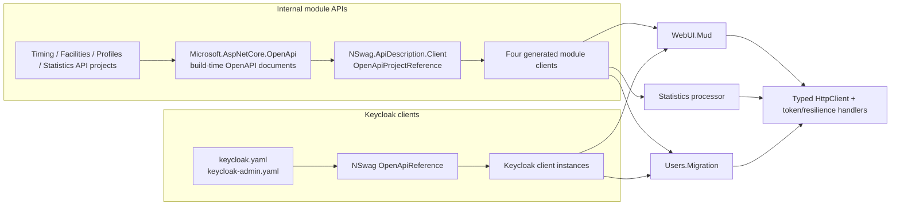

# Impact of moving VeloTimer API client generation from NSwag to Kiota

## Executive summary

VeloTimer currently uses **NSwag 14.7.1** to generate C# clients in six project files: four clients for internal APIs and three Keycloak client instances across the UI and migration worker. The internal clients are generated from live API project references; Keycloak clients are generated from checked-in YAML specifications. The API-side OpenAPI producer (`Microsoft.AspNetCore.OpenApi`) is a separate layer and need not be replaced just to change the client generator.

The change is materially larger than replacing a package or generator command. Production code is coupled to generated interfaces, operation method names and parameter shapes, typed `HttpClient` registration, generated DTOs, and NSwag exception semantics. In particular, UI error translation and no-content handling, migration error handling, and tests all name or construct NSwag `ApiException` types. Expect coordinated changes to client generation, DI/authentication wiring, service call sites, exception translation, and regression tests.

The repository already references `Microsoft.Kiota.Bundle` 2.0.0 in `WebUI.Mud` and `Users.Migration`, but local searches found no Kiota source usage or generation configuration. Treat that as an existing package reference—not evidence that a Kiota migration is already implemented. A low-risk path is to prototype a single module client first, prove the generated API shape and HTTP/error behavior against existing tests, then migrate other modules and Keycloak clients in separate steps.

## Scope and evidence boundaries

This assessment is based on local repository inspection only. It establishes the current architecture and migration blast radius. It does **not** validate Kiota CLI/MSBuild setup, exact generated names, runtime exception behavior, or compatibility with the current OpenAPI documents. Those need a focused Kiota prototype and should not be assumed from the package reference alone.

## Architecture overview

The four API projects produce OpenAPI documents, while separate client projects consume those projects through `OpenApiProjectReference`. The Keycloak clients instead use static, checked-in YAML through `OpenApiReference`. Both modes currently select `NSwagCSharp`.[^2][^6]

## Current generation inventory

| Area | Current generation source | Generated client(s) | Migration significance |
|---|---|---|---|
| Timing, Facilities, Profiles, Statistics | Each corresponding API `.csproj` via `OpenApiProjectReference` | `TimingClient`, `FacilitiesClient`, `ProfilesClient`, `StatisticsClient` | Four module client projects and their callers |
| Web UI Keycloak integration | `api/keycloak.yaml` and `api/keycloak-admin.yaml` via `OpenApiReference` | `KeycloakClient`, `KeycloakAdminClient` | Static-spec path; UI registration and Keycloak callers |
| User migration worker | `api/keycloak-admin.yaml` via `OpenApiReference` | A separate `KeycloakClient` | Worker registration and migration error handling |

The four internal client projects use the same generator options: `/UseBaseUrl:false /GenerateClientInterfaces:true`. Their handwritten extensions set an Aspire service-discovery base address and register generated interface/implementation pairs as typed clients. The two Keycloak specs are checked in; generated internal API JSON documents are ignored build output.[^7][^8]

### Package and project boundaries

- `NSwag.ApiDescription.Client` is centrally pinned to 14.7.1. `Microsoft.Extensions.ApiDescription.Server` is pinned separately and produces API descriptions; replacing the client generator does not, by itself, require removing this producer package.[^1][^2]
- `Microsoft.Kiota.Bundle` 2.0.0 is already centrally pinned and referenced in `WebUI.Mud` and `Users.Migration`; local repository searches found no Kiota code-generation config, generated-client usage, or source references. Confirm whether those references are intentional before changing/removing them.[^1][^5]
- Generation happens as part of normal project builds through MSBuild items, rather than a checked-in standalone NSwag configuration file or an explicit CI generation command.[^1][^9]

## Compatibility and migration impact

### 1. Generation wiring and OpenAPI document production

There are two distinct generator inputs. Internal clients use project references to API projects; Keycloak clients use static YAML files. Any Kiota rollout must cover both kinds of input and all generation consumers, not only the four `*.Client` projects.[^2][^6]

The API host projects also have special behavior for the NSwag document-generation process: hosting/authentication startup checks are skipped when the assembly name is `GetDocument.Insider`. That coupling is associated with the current project-reference generation path. Whether it remains necessary depends on the replacement workflow; preserve it until a build proves it is unused, and avoid accidentally running application side effects during spec extraction.[^10]

**Implication:** keep the API document producer and client generator as separately evaluated decisions. A Kiota client generator can consume OpenAPI descriptions without requiring the API host's `AddOpenApi`/`MapOpenApi` layer to be replaced. The existing external YAML inputs may make a static-spec pilot simpler, while a module pilot exercises the more coupled project-reference path.[^2][^10]

### 2. Generated types, DI, and service discovery

The current module registrations use `AddHttpClient<IThingClient, ThingClient>(...)`; for example, `AddTimingClient` sets `https+http://module-timing-api` as the base address. UI registrations chain access-token and resilience handlers, and similar typed-client registration patterns are used for Keycloak.[^3][^11]

This means generated clients are not isolated build artifacts: their interfaces and construction pattern are part of the DI boundary. A Kiota-generated client may require different construction/configuration. The repository alone does not establish the exact Kiota constructor or adapter setup, so confirm those by generating a real client before deciding how to retain service discovery, token forwarding, and resilience. If the new generated class is not a direct typed-client replacement, a handwritten adapter/facade can preserve a stable application-facing contract during migration.

### 3. Operation names and call signatures

Current code calls flat, generated async methods with positional/nullable parameters and named cancellation-token arguments. For example, UI services call `LayoutsAsync` and `FacilityAllAsync`; statistics clients expose multi-parameter query operations, and Keycloak admin operations include generated names such as `UsersGET2Async` and `UsersAll3Async`. Tests also inspect argument positions for these generated operations.[^3][^12]

The generated identifiers are not uniformly explicit. Some endpoint registrations pin names with `.WithName(...)`; others rely on inferred names. A replacement generator may produce different method names or a different request-building style, even for the same OpenAPI operation. Before migrating callers, inventory the generated operation IDs and method names for the pilot and verify behavior for optional query values, paging, dates, and cancellation.[^12][^13]

There is an existing `operationId` stability gate: `TimingEndpointTests` checks selected no-content operation IDs and their declared response codes in the OpenAPI document. Preserve and extend this kind of contract check while changing generators. A repository assessment has not established that every endpoint has a stable explicit operation ID, so do not assume naming parity.[^13]

### 4. Exceptions, error bodies, and no-content behavior

NSwag exception types are consumed directly in production:

- `AdministrationClientCall` recognizes client-specific `ApiException` types, translates status codes and response details, and has special no-content handling.[^14]
- UI services and migration writers catch generated `ApiException` types and branch on `StatusCode`; one Keycloak lookup treats 404 as an unavailable account while preserving other failures as errors.[^4][^15]
- `ProfilesClientTests` explicitly protects status and problem-code preservation across typed `ApiException<ProblemDetails>` and raw-response forms.[^16]

The no-content wrapper has a notable compatibility contract: it accepts the full 200–299 range when the generated client throws an exception for a success code other than the exact declared response, but propagates non-success exceptions and unrelated failures. Tests drive real generated clients through mutation calls, verify cancellation reaches the transport, and check error-detail preservation.[^14]

**Implication:** treat exception/error handling as a first-class migration workstream. Establish a shared boundary that can translate the replacement client's failures into the application's existing HTTP/status/detail semantics, or migrate each consumer with equivalent tests. Do not mechanically replace exception names without reproducing typed ProblemDetails handling, 404 policy, transport/cancellation distinctions, and the 2xx no-content contract.[^14][^16]

### 5. JSON and model compatibility

The API side produces OpenAPI using ASP.NET Core's OpenAPI support, while current generated clients depend on Newtonsoft.Json. The internal client projects list both `NSwag.ApiDescription.Client` and `Newtonsoft.Json`; generated code in `obj/` confirms Newtonsoft-based serialization. API model contracts live in the `*.Interface` projects and are also used by other parts of the system.[^2][^17]

Moving to a generator/runtime with different serializer defaults can affect property naming, nullable values, dates, additional properties, polymorphism, and unknown fields. The repository contains tests for null-valued profile fields, problem payloads, and exact query serialization; retain those as contract tests and add representative round-trip tests for the generated DTOs before changing serializer behavior.[^16][^18]

### 6. Test and build impact

The useful safety net is broader than generator compilation:

- `NoContentClientCallTests` covers status handling, transport failures, cancellation, real client mutation calls, and BFF responses.[^14]
- `ProfilesClientTests` covers status/problem-code preservation, null handling, transport failures, and in-flight cancellation.[^16]
- `TransponderOwnerServiceTests` covers generated Keycloak admin query argument behavior, deduplication, 404 semantics, failure attribution, and malformed identities.[^19]
- Other platform tests exercise paging, UTC query serialization, mappings, and generated-client consumers.[^18][^20]

The CI workflow runs the solution's .NET tests; the repository instructions identify `dotnet test` and Release `dotnet build` as the baseline. A generator migration should compile and pass focused client/API tests first, then the full test suite and Release build.[^9][^21]

## Recommended rollout

1. **Confirm intent and package state.** Establish why `Microsoft.Kiota.Bundle` is already referenced and whether the target is every generated client or only module clients. Do not equate the existing package reference with an implemented migration.[^1][^5]
2. **Choose one pilot.** Pick one module client with representative query/body operations and known consumers. Keep the existing API OpenAPI producer and compare generated behavior rather than changing server and client generation simultaneously.[^2]
3. **Prove generation and runtime wiring.** Generate the pilot from the actual OpenAPI document. Verify operation IDs, required/optional query parameters, date and nullable DTOs, error response shapes, service-discovery base URL, access-token handler, resilience handler, and cancellation. The exact Kiota setup is outside the evidence collected here.
4. **Preserve application-facing behavior.** Either update the pilot's consumers together or put a handwritten adapter around the new generated client. Keep status/detail mapping centralized where practical and make behavior parity explicit in tests.[^3][^14]
5. **Migrate by boundary.** Move remaining module clients one at a time, then the static Keycloak clients. Keycloak static specs provide a separate path from API project-reference generation, so they can be handled independently.[^6][^7]
6. **Remove NSwag only when unused.** Remove its package references and generated-code-specific dependencies only after all generation items and exception/client usages have been migrated. Keep `Microsoft.Extensions.ApiDescription.Server` if API OpenAPI production remains in use.[^1][^2]
7. **Validate in layers.** Run affected client/API tests and platform tests, then the full CI test command and Release build. Compare operation IDs and response codes as part of contract validation, rather than relying solely on successful compilation.[^9][^13][^21]

## Key repository areas

| Area | Files to inspect/change |
|---|---|
| Central package versions | `Directory.Packages.props` |
| Internal OpenAPI producer projects | `src/Module.{Timing,Facilities,Profiles,Statistics}.Api/` |
| Internal generated client projects and DI extensions | `src/Module.{Timing,Facilities,Profiles,Statistics}.Client/` |
| Static external API specifications | `api/keycloak.yaml`, `api/keycloak-admin.yaml` |
| External client generation and registration | `src/WebUI.Mud/`, `src/Users.Migration/` |
| Application call sites / exception adaptation | `src/WebUI.Mud/Services/`, `src/Users.Migration/Services/`, `src/Module.Statistics.Processor/` |
| Client/API regression tests | `src/Module.Profiles.Api.Test/ProfilesClientTests.cs`, `src/VeloTime.Platform.Test/NoContentClientCallTests.cs`, `src/VeloTime.Platform.Test/TransponderOwnerServiceTests.cs`, `src/Module.Timing.Api.Test/TimingEndpointTests.cs` |
| CI validation | `.github/workflows/ci.yml`, `.github/workflows/publish.yml` |

## Confidence assessment

**High confidence:** the active generator is NSwag 14.7.1; the six project files and seven generated-client instances are identifiable; internal and Keycloak inputs follow different generation paths; generated interfaces, methods, exception types, serializer dependencies, and test contracts are used throughout the application.

**Moderate confidence:** exact migration effort will depend on whether a Kiota-generated client can be wrapped to preserve the existing typed-client boundary and on how its output represents current OpenAPI operations. The repository supports the need to verify these compatibility points, but does not supply a Kiota-generated artifact.

**Not established by this research:** Kiota version/tooling configuration, exact generated request-builder names, exception type/member behavior, runtime adapter setup, performance differences, or a recommendation to switch based on maintenance/security/feature comparisons. Those require a bounded prototype and, for comparative product claims, external documentation/research.

## Footnotes

[^1]: `Directory.Packages.props:5,50,52,63`; `src/WebUI.Mud/VeloTime.WebUI.Mud.csproj:24`; `src/Users.Migration/VeloTime.Users.Migration.csproj:28,31`.
[^2]: `Directory.Packages.props:36,38,41`; `src/Module.Facilities.Api/VeloTime.Module.Facilities.Api.csproj:11-17`; `src/Module.Timing.Api/Program.cs:16,34`.
[^3]: `src/Module.Timing.Client/Extensions.cs:1-13`; `src/WebUI.Mud/Program.cs:116-144`; `src/WebUI.Mud/Services/FacilityService.cs:9-14`.
[^4]: `src/Users.Migration/Services/OwnershipMigrationWriter.cs:40-48`; `src/Users.Migration/Services/StatsProfileMigrationWriter.cs:26-31`; `src/WebUI.Mud/Services/TransponderOwnerService.cs:117-158`.
[^5]: `src/WebUI.Mud/VeloTime.WebUI.Mud.csproj:24`; `src/Users.Migration/VeloTime.Users.Migration.csproj:28`; repository-wide local search reported no Kiota code usages or generation config.
[^6]: `src/WebUI.Mud/VeloTime.WebUI.Mud.csproj:51-59`; `src/Users.Migration/VeloTime.Users.Migration.csproj:46-52`.
[^7]: `src/Module.Timing.Client/VeloTime.Module.Timing.Client.csproj:9-21`; `src/Module.Facilities.Client/VeloTime.Module.Facilities.Client.csproj:9-19`; `src/Module.Profiles.Client/VeloTime.Module.Profiles.Client.csproj:10-23`; `src/Module.Statistics.Client/VeloTime.Module.Statistics.Client.csproj:9-19`; `.gitignore:376-379`.
[^8]: `src/Module.Timing.Client/Extensions.cs:1-13`; `src/Module.Facilities.Client/Extensions.cs:1-13`; `src/Module.Profiles.Client/Extensions.cs:1-11`; `src/Module.Statistics.Client/Extensions.cs:1-13`.
[^9]: `.github/workflows/ci.yml:45-50`; `.github/workflows/publish.yml:60-93`; `Directory.Packages.props:63`.
[^10]: `src/Module.Common/HostingExtensions.cs:42-45`; `src/Module.Timing.Api/Program.cs:19-20`.
[^11]: `src/WebUI.Mud/Program.cs:116-144`; `src/Module.Statistics.Processor/HostingExtensions.cs`.
[^12]: `src/Module.Timing.Client/obj/VeloTime.Module.Timing.ApiClient.cs:27-100`; `src/Module.Statistics.Client/obj/VeloTime.Module.Statistics.ApiClient.cs:32-80`; `src/WebUI.Mud/Services/TransponderOwnerService.cs:94-98,130`; `src/VeloTime.Platform.Test/TransponderOwnerServiceTests.cs:85-98,116-130`.
[^13]: `src/Module.Timing.Api.Test/TimingEndpointTests.cs:16-34`; `src/Module.Timing.Api/Endpoints/OwnershipEndpoints.cs:19-38`; `src/Module.Facilities.Api/Endpoints/FacilityEndpoints.cs:21-23`; `src/Module.Statistics.Api/Endpoints/PublicStatisticsEndpoints.cs:16-18`.
[^14]: `src/WebUI.Mud/Services/AdministrationClientCall.cs:1-49`; `src/VeloTime.Platform.Test/NoContentClientCallTests.cs:23-47,50-65,67-136,184-215`.
[^15]: `src/WebUI.Mud/Services/TransponderOwnerService.cs:117-158`; `src/Users.Migration/Services/OwnershipMigrationWriter.cs:40-48`; `src/Users.Migration/Services/StatsProfileMigrationWriter.cs:26-31`.
[^16]: `src/Module.Profiles.Api.Test/ProfilesClientTests.cs:12-91`.
[^17]: `src/Module.Timing.Client/VeloTime.Module.Timing.Client.csproj:9-13`; `src/Module.Facilities.Client/VeloTime.Module.Facilities.Client.csproj:9-13`; `src/Module.Timing.Client/obj/VeloTime.Module.Timing.ApiClient.cs:1-4`; `src/Module.Timing.Interface/`.
[^18]: `src/VeloTime.Platform.Test/TransponderManagementUtcRangeHttpServiceTests.cs:13-62`; `src/VeloTime.Platform.Test/TransponderPaginationServiceTests.cs:13-38`; `src/Module.Profiles.Api.Test/ProfilesClientTests.cs:44-57`.
[^19]: `src/VeloTime.Platform.Test/TransponderOwnerServiceTests.cs:85-98,116-130,235-257`.
[^20]: `src/VeloTime.Platform.Test/PlatformServiceTests.cs:573-599`; `src/VeloTime.Platform.Test/BestStatisticsServiceTests.cs`; `src/VeloTime.Platform.Test/DisplayPreferenceBffTests.cs`.
[^21]: `AGENTS.md` (Working In The Repository); `.github/workflows/ci.yml:45-50`; `.github/workflows/publish.yml:60-93`.
