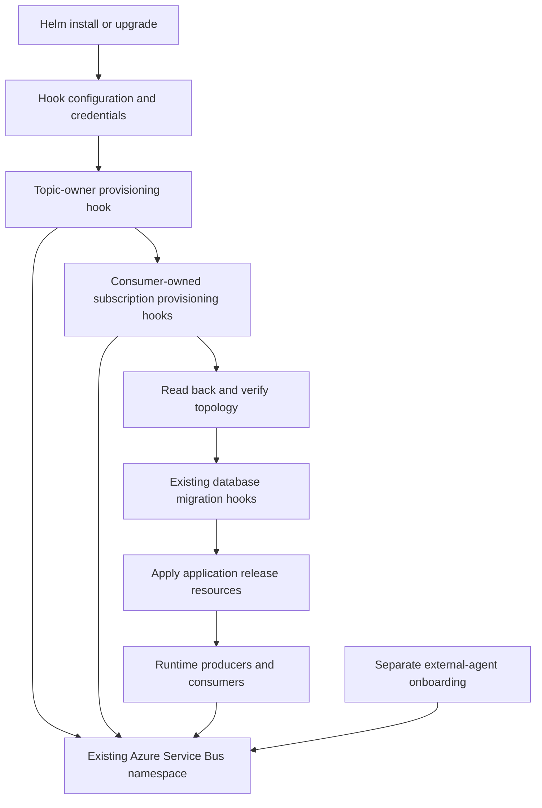

# Messaging topology provisioning during Helm installation and upgrade

## Executive summary

**Use Helm `pre-install,pre-upgrade` hook Jobs to provision messaging topology before application rollout, following the lifecycle already used for database migrations. Evaluate SlimMessageBus's built-in topology provisioner first; use a custom Azure Service Bus administration reconciler only if the built-in functionality cannot satisfy the required deployment-only behavior.** VeloTimer already has ordered migration hooks and a worker contract that produces a nonzero exit on failure.[^1][^2]

Provisioning does not inherently require one global executable. Per-service provisioning is a suitable ownership model: producers/domain owners manage shared topics, while consumers manage their subscriptions and complete filter sets. However, a provisioning-only SlimMessageBus lifecycle, concurrent rule-management behavior, and effective provider defaults were not established by this local research.[^3][^4]

The recommendation is a design proposal, not an implemented or integration-tested solution.

## Scope

Research covered the repository's Helm charts, AppHost, messaging registrations, installed package documentation, migration workers, deployment workflows, and tests. Follow-up investigation considered SlimMessageBus reuse and distributed producer/consumer ownership.

Only local evidence was used. No Azure namespace inspection, live Helm deployment, build, or integration test was performed. No source commit SHA was established, so citations refer to repository paths and line numbers rather than commit-pinned URLs.

| Repository | Relevant areas |
|---|---|
| [asbjorjo/VeloTimer](https://github.com/asbjorjo/VeloTimer) | Helm charts, migration workers, messaging hosts, chart tests, publishing workflows |

## 1. Existing deployment and messaging behavior

### Database migrations already provide the deployment gate

The main chart renders migration Jobs for Facilities, Statistics, Timing, and Profiles. Their Secret/ConfigMap prerequisites have hook weight `-20`; Jobs have weights `0` through `3`. Jobs use `pre-install,pre-upgrade`, `restartPolicy: Never`, and deletion policy `before-hook-creation,hook-succeeded`, retaining failed Jobs until a subsequent attempt or explicit cleanup.[^1]

The README documents that Helm waits for these hook Jobs even without `--wait`. Database migrations do not run merely because an application pod restarts. Defaults are `backoffLimit: 1` and `activeDeadlineSeconds: 600` per Job.[^5]

The shared EF worker sets `Environment.ExitCode = 1`, records the failure in its activity, and rethrows. On success it calls `StopApplication()`. A messaging worker should preserve those completion semantics without inheriting the EF-specific `MigrationWorker<T>`.[^2]

The standalone bootstrap and users-migration charts use different Job conventions. Prefer the main chart's explicit ordered-hook pattern for new messaging provisioning.[^6]

### AppHost supplies a connection, not topology

AppHost declares:

```csharp
var servicebusconnection = builder.AddConnectionString("MessageBus");
```

It forwards this reference to the Timing API and Timing/Statistics processors. It does not declare a Service Bus namespace, topics, subscriptions, or rules.[^7]

The initial proposal therefore manages entities inside an existing namespace. Creating the namespace or its external identities would be a separate infrastructure concern.

### Runtime provisioning is not uniformly configured

| Host | Observed configuration |
|---|---|
| Agent | Explicit `TopologyProvisioning.Enabled = false`, despite enabled subscription/filter creation and validation flags |
| Timing API | Explicit provisioning disabled; comment says the Timing topic is provisioned externally |
| Timing processor | No explicit topology provisioning override |
| Statistics processor | No explicit topology provisioning override |

These facts do **not** establish that provisioning is disabled everywhere. The processors inherit a library default that was not independently verified.[^3][^4][^8]

### Initial topology inventory

This describes declarations in application code, not actual Azure entity state.[^3][^4][^8]

| Topic | Subscription | Declared messages | Session expectations |
|---|---|---|---|
| `velotime-agent-test` | `timing` | `PassingEvent` | Session-enabled consumer |
| `velotime-agent-test` | `infrastructure` | `InstallationLayoutEvent`, `LoopStatusEvent` | Confirm existing settings; do not infer session requirements from other subscriptions |
| `velotime-timing-test` | `statistics` | `TimingSampleComplete`, `TransponderOwnershipChanged` | Retain session support |
| `velotime-statistics-test` | `statistics` | `EntryCreated`, `SampleComplete` | Session-enabled consumers |
| Agent's configured topic | Per-agent subscription | `PauseAgentCommand`, `ResumeAgentCommand` | Separate agent lifecycle and correlation filter |

The README explicitly requires externally managed filters on the Timing topic's Statistics subscription to allow both `TimingSampleComplete` and `TransponderOwnershipChanged` by `MessageName`, retaining sessions.[^9]

**Resolve naming before implementation:** Agent defaults its configurable topic to `velotime-agent`, whereas the Timing processor declares `velotime-agent-test`. Confirm deployed overrides; silently creating both would not connect mismatched producers and consumers.[^3][^4]

## 2. Evaluate SlimMessageBus before duplicating provisioning logic

SlimMessageBus already exposes separate producer and consumer provisioning controls through `ServiceBusTopologySettings`. The Agent configuration includes consumer topic/subscription/filter controls and producer topic controls, demonstrating that the available surface is not restricted to one central application.[^3]

The centrally managed packages are SlimMessageBus `3.4.0`; the installed provider depends on Azure Service Bus SDK `7.20.1`.[^10]

| Option | Assessment |
|---|---|
| SlimMessageBus provisioning in a deployment-only executable | First choice to investigate: reuse existing declarations and provider logic |
| Explicit `ServiceBusAdministrationClient` reconciler | Fallback when deployment-only lifecycle, ownership, validation, or updates cannot be satisfied by the built-in provisioner |
| Normal service startup provisioning | Possible ownership model, but not equivalent to a chart-controlled pre-rollout migration gate |

Local package inspection found provisioning and consumer-creation members, but did not prove a supported public provisioning-only entry point. The Azure SDK documentation does establish topic/subscription/rule read, create, update, and delete APIs.[^11]

**Do not treat `AutoStartConsumersEnabled(false)` as a no-consumption mode.** The Timing API uses it alongside an explicit `bus.Start()`. This demonstrates suppression of automatic startup, not proof that calling `Start()` leaves configured consumers inactive.[^8]

Before choosing SlimMessageBus for a hook executable, demonstrate:

1. Topology can be provisioned without starting message pumps, publishing outbox messages, or otherwise running application workers.
2. Repeated execution is safe against existing topics, subscriptions, and rules.
3. Filter creation, validation, and replacement preserve the complete intended filter set.
4. Session/configuration mismatches are detected without destructive recreation.
5. Provisioning failures and cancellation produce a nonzero process exit.

These are proof-of-concept requirements, not claims about verified provider behavior.

## 3. Per-service ownership versus one global process

**A global topology executable is not inherently required.** Each service has its own SlimMessageBus registrations. A deployment executable may provision that service's portion, subject to validating the provision-only lifecycle.[^3][^4]

Distinguish two forms of granularity:

- **Per bus/service:** the service declares its producers/consumers and configures provisioning permissions for that bus.
- **Per individual registration:** this research did not prove that every `.Produce<T>()` or `.Consume<T>()` has an independent provisioning toggle.

Recommended ownership:

| Entity | Owner |
|---|---|
| Shared topic and topic-wide properties | Producer/domain owner |
| Subscription and its complete rule/filter set | Consumer service |
| Per-agent control subscription | Explicit agent onboarding owner |

The boundary is the **broker entity**, not the individual message type. `TimingSampleComplete` and `TransponderOwnershipChanged` share the same Timing-topic Statistics subscription. Likewise, Timing infrastructure messages share a subscription. Splitting their filter management among independent jobs could introduce conflicting desired states; no safe rule-replacement guarantee was established locally.[^4][^9]

Multiple per-service Helm Jobs can therefore preserve service boundaries without creating one central project that references every consumer. If shared-entity ownership or the provider's rule behavior cannot be made unambiguous, a single aggregate job remains a reasonable alternative.

## 4. Proposed chart architecture



This is proposed ordering, not an existing chart implementation. Negative weights between the existing `-20` prerequisites and domain Jobs `0..3` could place messaging first. Assign distinct weights when topic creation must precede subscription creation; do not depend on incidental ordering of equal-weight resources.[^1]

No demonstrated data dependency requires messaging before database migrations. The essential requirement is that all required provisioning succeeds before application rollout.

Illustrative hook annotations:

```yaml
annotations:
  helm.sh/hook: pre-install,pre-upgrade
  helm.sh/hook-weight: "-10"
  helm.sh/hook-delete-policy: before-hook-creation,hook-succeeded
```

Actual templates must follow existing chart naming, labels, image tags, pull settings, timeout/retry settings, and configuration validation. Existing migration configuration supplies DB/OIDC settings, not a dedicated messaging-management credential, so new template/schema wiring is needed.[^1][^12]

### Credentials and first install

Use a separate management-capable identity or Secret; do not assume a runtime send/receive credential can create topology. The demonstrated application configuration convention is `ConnectionStrings__MessageBus`.[^8]

A pre-created Secret is the simplest initial pattern. Any chart-created configuration required by a pre-install Job must itself be available in the earlier hook phase, following the main chart's hooked migration configuration. Do not make the hook depend on ordinary application resources that appear later.[^1]

Workload identity is an alternative to validate, not an existing Service Bus authentication setup proven by this research. Verify identity/ServiceAccount prerequisites and required permissions before using it for pre-install hooks.

## 5. Reconciliation and safety

Begin with additive desired-state reconciliation on every install/upgrade:

```text
validate configuration and ownership
read/create owned topics
read/create owned subscriptions with intended creation settings
reconcile approved mutable properties and complete owned rule sets
read back and verify
success: stop the host normally
failure/cancellation: record error, set exit code 1, rethrow
```

This is pseudocode, not verified SDK signatures. It combines the existing worker's process contract with available administration primitives.[^2][^11]

A messaging version-history database is not required merely to copy EF's lifecycle. Add recorded migration steps if later changes require cutovers, retirement, or audit history; readback remains necessary even when a version is recorded.

Required safety policies:

- Replay partial operations safely; on an already-exists race, reread and verify.
- Manage only declared entities and explicitly owned rules.
- Preserve required session settings; validate exact property mutability before implementation.
- Inspect broad/default rules rather than assuming a new restricted rule removes them.
- Preserve both documented Statistics message types during upgrades.
- Treat renames, incompatible creation settings, and deletion as planned expand/contract changes.
- Never automatically prune unknown entities or delete/recreate subscriptions containing messages, dead letters, or session state.
- Fail explicitly on authentication errors, incompatibility, timeouts, and verification mismatch.
- Do not treat Helm rollback as broker-state rollback.
- Coordinate independently deployed owners of shared entities; retries alone do not resolve incompatible desired states.

These are design requirements. The local research did not establish transactional multi-entity provisioning, exact rule-generation behavior, or concurrency guarantees.[^9][^11]

## 6. Dynamic agents require a separate lifecycle

Concrete agents can appear without a VeloTimer chart upgrade. Their per-agent subscriptions and `agentId` correlation filters therefore cannot be fully covered by a static chart provisioning Job.[^3]

Assign an explicit onboarding owner: operator workflow, trusted central provisioning component, or deliberately enabled and tested narrowly scoped agent-side provisioning. Do not include per-agent entity deletion in static chart orphan cleanup.

## 7. Implementation and validation plan

1. Confirm deployed topic names, existing rules, session settings, and entity ownership.
2. Prove SlimMessageBus provisioning-only behavior before introducing an administration reconciler.
3. Implement per-service deployment executables where ownership is unambiguous; reuse declarations without registering normal application workers.
4. Follow migration-container packaging conventions and verify the existing solution-level publish command produces the new images.[^13]
5. Add hook templates, credential references, values/schema, ordering, retry/deadline settings, and documentation.
6. Extend chart tests for install/upgrade rendering, toggles, prerequisite ordering, Secret references, new configuration, image settings, invalid input, and name uniqueness.[^14]
7. Validate real Azure provisioning: fresh creation, unchanged rerun, mutable drift, partial failure, routing, session compatibility, identity failure, and concurrent starts.
8. Validate real Helm failure gating and compatibility while the old release is running.
9. Only after successful validation, explicitly transfer static topology ownership away from processor startup provisioning.

Existing chart validation command:

```sh
python3 -m unittest discover -s charts/tests -v
```

CI prepares Helm dependencies and installs the chart test requirements before running it. Rendering alone cannot establish actual broker routing, permissions, or rollout failure gating.[^14]

## Confidence assessment

**High confidence:** existing ordered migration hooks, nonzero migration-worker failure semantics, external AppHost connection model, explicit Agent/Timing API provisioning settings, shared consumer subscription declarations, and the documented dual-message/session requirement.[^1][^2][^3][^4][^7][^8][^9]

**Proposed design:** per-service Helm provisioning Jobs, topic/subscription ownership split, additive reconciliation, separate management credentials, and SlimMessageBus-first implementation preference.

**Unresolved:** provider defaults, supported provisioning-only lifecycle, exact filter reconciliation/concurrency behavior, actual deployed namespace state, creation-property mutability, permissions, workload identity, and live Helm/Azure behavior.[^11]

**Assumptions:** Azure Service Bus remains the transport; the namespace is provisioned externally; scope is install/upgrade entity management, not automatic namespace creation or destructive broker rollback.

## Footnotes

[^1]: [charts/velotime/templates/migration-jobs.yaml](../../charts/velotime/templates/migration-jobs.yaml), lines 7-77. Domain iteration, prerequisite hooks, Job weights, restart/deletion policies, images, and configuration.
[^2]: [src/Module.Common/MigrationWorker.cs](../../src/Module.Common/MigrationWorker.cs), lines 9-46. EF migration execution, error tracing, explicit exit code, rethrow, and normal host completion.
[^3]: [src/Agent/HostingExtensions.cs](../../src/Agent/HostingExtensions.cs), topology/provider and producer/consumer blocks around lines 57-132; [src/Agent/Messaging/MessageBusOptions.cs](../../src/Agent/Messaging/MessageBusOptions.cs), line 8. Provisioning controls, configurable topic, per-agent subscription, and correlation filter.
[^4]: [src/Module.Timing.Processor/HostingExtensions.cs](../../src/Module.Timing.Processor/HostingExtensions.cs), lines 24-73; [src/Module.Statistics.Processor/HostingExtensions.cs](../../src/Module.Statistics.Processor/HostingExtensions.cs), lines 24-83. Independent registrations, shared topic/subscription names, producers, and session-enabled consumers.
[^5]: [README.md](../../README.md), lines 734-747 and 800-815. Documented hook completion, domain order, retries/deadlines, and cleanup.
[^6]: [charts/velotime-migration/charts/velotime-users-migration/templates/job.yaml](../../charts/velotime-migration/charts/velotime-users-migration/templates/job.yaml), lines 1-27; [charts/velotime-bootstrap/templates/job.yaml](../../charts/velotime-bootstrap/templates/job.yaml), lines 1-45. Alternative existing Job conventions.
[^7]: [src/AppHost/AppHost.cs](../../src/AppHost/AppHost.cs), line 47 and references at lines 100, 148, and 158; [src/AppHost/VeloTime.AppHost.csproj](../../src/AppHost/VeloTime.AppHost.csproj), lines 1-18. External connection-string resource and hosting dependencies.
[^8]: [src/Module.Timing.Api/MessagingExtensions.cs](../../src/Module.Timing.Api/MessagingExtensions.cs), provider/startup blocks around lines 19-65; [README.md](../../README.md), lines 540-547. Explicit provisioning disabled, automatic-start suppression, explicit bus startup, external topic, and connection configuration.
[^9]: [README.md](../../README.md), lines 563-566. Timing Statistics subscription must accept ownership changes and timing samples by `MessageName`, retaining session support.
[^10]: [Directory.Packages.props](../../Directory.Packages.props), SlimMessageBus package entries around lines 22-27 and 68-77; local package `slimmessagebus.host.azureservicebus/3.4.0/slimmessagebus.host.azureservicebus.nuspec`, lines 18-33. Versions were inspected during research; line positions differed between reads as the shared checkout evolved.
[^11]: Local installed `azure.messaging.servicebus/7.20.1/lib/net8.0/Azure.Messaging.ServiceBus.xml`, lines 371-398, 518-532, 1588-1606, and 3474, plus administration method documentation. SDK CRUD and session-setting surface. Local SlimMessageBus package inspection did not establish a public provision-only lifecycle, default provisioning value, or concurrency guarantees.
[^12]: [charts/velotime/templates/migration-jobs.yaml](../../charts/velotime/templates/migration-jobs.yaml), lines 29-77; [charts/velotime/values.schema.json](../../charts/velotime/values.schema.json), lines 1-45. Existing migration credential/configuration and override surface.
[^13]: [src/Module.Facilities.Migration/Program.cs](../../src/Module.Facilities.Migration/Program.cs), lines 1-12; [src/Users.Migration/Program.cs](../../src/Users.Migration/Program.cs), worker registration around line 43; [.github/workflows/publish.yml](../../.github/workflows/publish.yml), lines 94-97. Worker entrypoint precedent and solution-level container publish.
[^14]: [charts/tests/test_migration_hooks.py](../../charts/tests/test_migration_hooks.py), lines 14-21 and 37-159; [.github/workflows/charts-ci.yml](../../.github/workflows/charts-ci.yml), lines 29-65; [charts/tests/requirements.txt](../../charts/tests/requirements.txt), line 1. Rendering, existing regression coverage, dependency setup, and Python runner.
