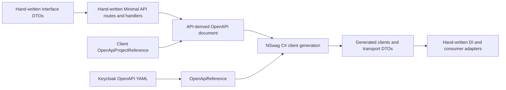
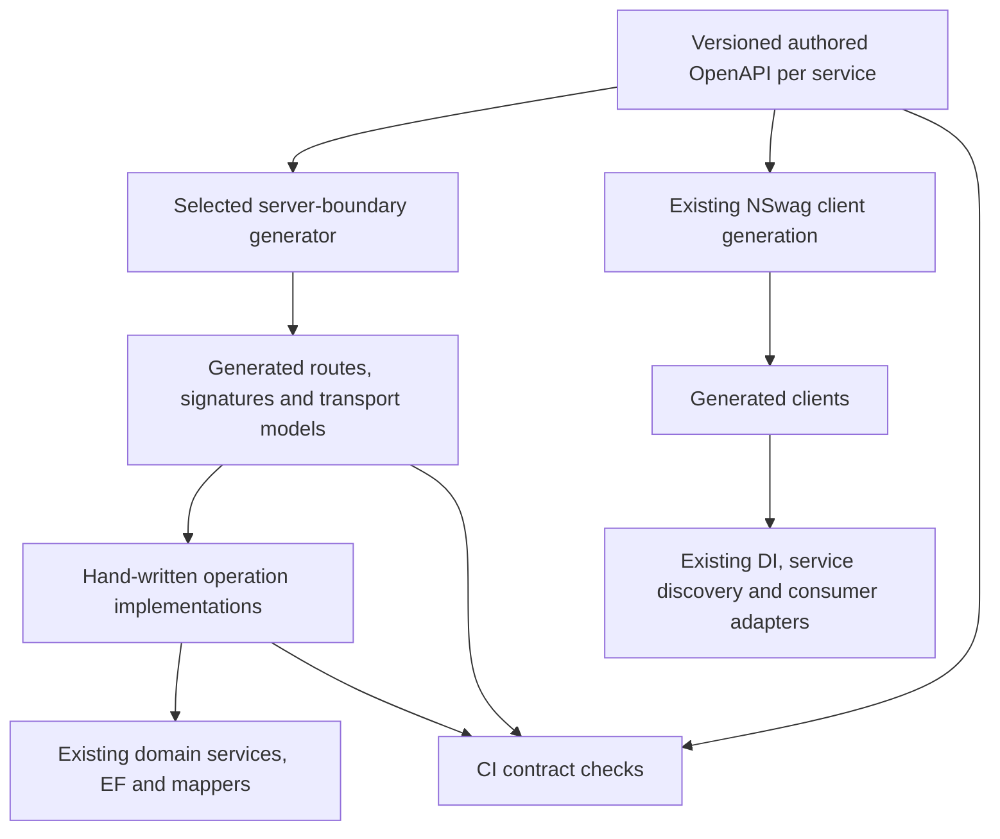

# Specification-first API contracts for VeloTimer

## Executive summary

**Yes, specification-first is a viable architectural direction, but generating clients and generating server endpoints are two different levels of change.** VeloTimer already generates C# clients with NSwag, and its Keycloak integrations demonstrate generation directly from an OpenAPI file. The four module APIs instead use hand-written Minimal APIs and API-project references to generate their clients.[^1][^2][^3] Replacing those references with authored specifications is a well-supported starting point within this repository; generating the server's route registrations, transport types and implementation signatures requires a new, separately validated generator path.[^4] The recommended approach is a small specification-first **server-and-client** pilot that keeps EF queries, domain rules, authorization policy evaluation and mapping hand-written, then expands only after runtime and contract parity are demonstrated.[^5][^6]

**Decision:** approve an isolated proof of concept, not a wholesale conversion or a specific server generator yet. Local evidence establishes the integration opportunity, but does not establish which external generator currently supports the required .NET 10 Minimal API output.[^4][^7]

## Scope and evidence

This is a technical architecture and feasibility study of [asbjorjo/VeloTimer](https://github.com/asbjorjo/VeloTimer). Six focused research dispatches examined local build configuration, endpoints, generated documents, DTOs, client integration and tests. No external documentation was consulted, and no generator, build or test was executed. Tool capabilities not demonstrated in the repository are therefore evaluation candidates, not verified recommendations.

### Key repository surfaces

| Surface | Current responsibility | Relevance |
|---|---|---|
| [Module.Timing.Api](../../src/Module.Timing.Api), [Module.Facilities.Api](../../src/Module.Facilities.Api), [Module.Statistics.Api](../../src/Module.Statistics.Api), [Module.Profiles.Api](../../src/Module.Profiles.Api) | Hand-written HTTP endpoints | Server generation would replace the declarative boundary, not the domain implementation.[^1][^5] |
| Module client projects | NSwag-generated clients plus DI registration | Existing client integration should be retained.[^2][^8] |
| Module Interface projects | Hand-written shared contracts and some query validation | HTTP schema generation must not inadvertently redefine shared message contracts.[^9][^10] |
| [api](../../api) | Generated module documents, Keycloak YAML and public statistics handoff documentation | Natural contract location, but authored inputs must be distinct from generated outputs.[^3][^11][^12] |
| API test projects | Live-host, OpenAPI metadata and generated-client checks | Existing patterns provide migration acceptance gates.[^13][^14][^15] |

The links above identify one repository, not several related repositories. Source citations below use repository-relative links with observed starting line numbers in their labels because a current commit SHA was not established.

## 1. Current architecture



The API producer uses ASP.NET Core OpenAPI generation and configures an output directory under the repository's API directory. The module client consumer uses `OpenApiProjectReference` with `NSwagCSharp`; the Keycloak consumer instead uses `OpenApiReference` against a YAML file.[^1][^2][^3] The established dependency is **API project -> API document -> generated client**. This study does not rely on disputed details about NSwag's transient document storage or whether every emitted JSON file is tracked.

Representative current client configuration:

```xml
<OpenApiProjectReference
    Include="..\Module.Timing.Api\VeloTime.Module.Timing.Api.csproj"
    CodeGenerator="NSwagCSharp"
    Namespace="VeloTime.Module.Timing.Client"
    ClassName="TimingClient">
  <Options>/UseBaseUrl:false /GenerateClientInterfaces:true</Options>
</OpenApiProjectReference>
```

This is the existing project-reference pattern, not a proposed server-generation configuration.[^2] NSwag is centrally pinned to `14.7.1`; observed module documents use OpenAPI `3.1.1`. A version number alone does not prove fidelity for every 3.1 schema construct.[^7][^16]

### Operational coupling

Build-time OpenAPI extraction starts API hosts. The repository documents an explicit `OIDC_AUDIENCE` requirement for that tooling, and API startup contains a `GetDocument.Insider` guard around messaging registration.[^1][^17] File-based client generation could remove that API-host dependency **from client generation**, but would not remove authentication configuration needed by running or testing the API.

The four module JSON paths are explicitly listed in the ignore rules. Their existence on disk does not prove their index/tracking status; that was not independently established under the restricted local inspection.[^11] Authored specifications should use dedicated, tracked input paths rather than being written over by the current API-document output.

## 2. What “generate API endpoints” can mean

There are three useful levels of adoption. They should not be conflated.[^2][^4][^5]

| Level | Specification drives | Remaining hand-written code | Does it fulfill endpoint generation? |
|---|---|---|---|
| A. Specification-first clients | Client methods and transport models | All server routing and handlers | **No.** Useful foundation only. |
| B. Specification-first server boundary | Routes, binding signatures, response metadata and implementation contracts, as supported by the chosen tool | Domain operations, EF queries, mapping, policy evaluation and custom validation | **Yes**, for the HTTP boundary. Recommended target. |
| C. Generated application implementation | Storage operations and business decisions as well as the HTTP boundary | Substantial custom templates and application-specific logic | Not justified by this repository's patterns. |

OpenAPI can describe request/response shapes, parameters and declared outcomes. It does not supply VeloTimer's EF query, ownership transaction, cross-service dependency check or rule deciding when to return a conflict. Those implementations are visible in today's handlers and services and must remain code.[^5][^6][^18]

### Proposed architecture



This is a proposed design, not tooling already implemented. Its purpose is to preserve the existing business and client-integration seams while making the HTTP contract the common input.[^5][^8][^9]

**Ownership rule:** generated files are replaceable outputs; implementation files are never overwritten by regeneration. An API-derived document may remain a verification output, but must not regenerate or overwrite the authored specification. Each migrated operation must have exactly one route registration.[^1][^5][^19]

## 3. Generator options and trade-offs

| Option | Evidence in this repository | Fit for the request | Main decision or risk |
|---|---|---|---|
| **Retain NSwag for clients, reading authored files** | Existing `OpenApiReference` integrations with Keycloak | Strong first step; no client-generator swap required | Preserve client method names, DTO serialization and error behavior.[^3][^14] |
| **Evaluate NSwag server/controller generation** | No configured server generation found | Candidate for generating a server boundary | Verify actual output, framework support and extension seams; controller-shaped output may mean departing from the current Minimal API architecture.[^4][^5] |
| **Evaluate OpenAPI Generator ASP.NET server output** | No configured integration found | Alternative server-generation candidate | Verify supported .NET version, routing style, nullability, auth hooks and reproducibility; no capability claim is established here.[^4][^7] |
| **Evaluate a Minimal API-oriented generator** | No local implementation found | Closest architectural target if suitable output exists | Must support required metadata and regeneration-safe implementation hooks.[^4][^5] |
| **Build a small custom generator/template** | No existing in-house generator found | Can target current conventions precisely | Adds tooling ownership; defer until external candidates fail concrete requirements.[^4][^6] |

**Recommendation:** retain the proven NSwag client path and evaluate server tooling separately. Do not select a tool merely because it advertises “ASP.NET server” generation; inspect and compile its actual output against this repository's requirements. Conversely, do not conclude that custom tooling is necessary before testing available candidates.[^3][^4][^5]

External documentation or an executable prototype is necessary to complete the server-tool selection. This local-only study cannot honestly name a currently verified .NET 10 Minimal API server generator.[^4][^7]

## 4. Compatibility requirements specific to VeloTimer

### Authorization and hosting

Authorization includes named administration policies and a Keycloak realm-role transformation into permission claims. Other routes use authenticated identity as the resource key; public statistics routes explicitly allow anonymous requests.[^6][^10] Standard OpenAPI security requirements can describe authentication, but policy evaluation and user-resource ownership still need application code.

For generated routes, use an explicit, reviewed operation-to-policy mapping or validated generator extension. Unknown mappings must fail generation or validation rather than silently producing anonymous endpoints. Preserve middleware, strict JSON settings, endpoint filters and cache behavior outside the generated code.[^5][^6][^20]

### DTO and shared-contract ownership

`ITimingClient` is a generated HTTP client interface; `Module.Timing.Interface` is a different, hand-written contract project. Existing consumer code also maps transport DTOs at service boundaries.[^8][^9][^12]

Choose deliberately between:

1. Generated HTTP-only DTOs with mapping to existing shared contracts; or
2. Generating designated HTTP contracts into a dependency-light contract project.

The first is the safer pilot because it leaves shared events, commands and validation helpers untouched. Do not generate an entire Interface project from an HTTP specification or introduce implementation dependencies into shared contracts.[^9][^10][^12]

### Errors are not fully captured by current metadata

Some handlers return typed unions, others use `Task<IResult>` or manual response declarations. `AdministrationDependencyFilter` can produce 400, 404, 409 and 503 independently of a handler's success return signature. Public statistics endpoints demonstrate explicit problem-status declarations.[^18][^20]

Therefore, **do not freeze the current generated document as a complete contract without review**. Inventory runtime error outcomes and include them in the authored specification. Adding a broad `ProblemHttpResult` alone is not proof that each relevant status is documented. Generated signature checks and runtime negative-path tests serve different purposes.[^13][^18][^20]

### Wire semantics and client integration

Public statistics deliberately reads raw query strings to reject duplicate values and preserve custom parsing, while other endpoints use body-based filters or scalar pagination. Generated automatic binding must not silently change these semantics.[^10][^21]

Preserve the existing HTTP-client DI registrations and their service-discovery addresses. Shared service defaults apply discovery and resilience to HTTP clients; replacing generation should not replace that integration.[^8] Client parity includes problem status/code preservation, null versus successful values, transport failures and cancellation, all represented in existing Profiles client tests.[^14]

## 5. Concrete pilot: installation GET-by-id

### Why this operation

`GET /api/timing/installations/{id}` has a simple UUID parameter, an installation response and a bodyless 404. Its current implementation performs an EF lookup with timing points and maps the entity to a DTO.[^19][^22] It is a manageable server-generation seam without the public-statistics pagination or ownership-write complexity.

The inspected route has no attached authorization requirement and no observed fallback policy; the pilot must preserve that behavior, not introduce authentication as an incidental migration change. The current generated operation has **no `operationId`**, so introducing one is a client-code naming decision even if the wire path is unchanged.[^6][^19][^22]

### Current implementation

```csharp
static async Task<Results<Ok<InstallationDTO>, NotFound>> GetInstallationById(
    Guid id, TimingDbContext storage)
{
    var installation = await storage.Set<Installation>()
        .Include(i => i.TimingPoints)
        .FirstOrDefaultAsync(i => i.Id == id);
    if (installation == null)
    {
        return TypedResults.NotFound();
    }
    InstallationDTO installationData = installation.ToDto();
    return TypedResults.Ok(installationData);
}
```

This is the real handler body; the EF lookup and `ToDto` remain hand-written in the proposed architecture.[^19]

### Complete illustrative OpenAPI input

The following **proposed**, standalone document includes all schemas referenced by this one operation. It mirrors the inspected document's requiredness and nullability rather than strengthening the contract based on C# defaults. It adds an explicit operation identifier for the isolated pilot; exact generated method naming must be verified. OpenAPI 3.1.1 is an initial compatibility test, not a guarantee of server-generator support.[^7][^22]

```yaml
openapi: 3.1.1
info:
  title: VeloTime installation lookup pilot
  version: 1.0.0
paths:
  /api/timing/installations/{id}:
    get:
      operationId: GetInstallationById
      security: []
      parameters:
        - name: id
          in: path
          required: true
          schema:
            type: string
            format: uuid
      responses:
        '200':
          description: OK
          content:
            application/json:
              schema:
                $ref: '#/components/schemas/InstallationDTO'
        '404':
          description: Not Found
components:
  schemas:
    InstallationDTO:
      type: object
      required: [timingSystem]
      properties:
        id:
          type: string
          format: uuid
        facilityId:
          type: string
          format: uuid
        agentId:
          type: string
        lastSeen:
          type: ['null', string]
          format: date-time
        timingPoints:
          type: array
          items:
            $ref: '#/components/schemas/TimingPointDTO'
        timingSystem:
          $ref: '#/components/schemas/TimingSystemDTO'
        description:
          type: string
    TimingPointDTO:
      type: object
      required: [description, systemId]
      properties:
        id:
          type: string
          format: uuid
        description:
          type: string
        systemId:
          type: string
    TimingSystemDTO:
      type: object
      properties:
        name:
          type: string
```

Notably, the observed installation schema requires `timingSystem` but does not require every non-nullable C# property. That distinction is part of the current declared contract, not something to “fix” automatically during migration.[^9][^22]

### Client configuration

For an isolated pilot, add a separate client generated from the one-operation input; do **not** replace the full Timing client with an incomplete specification. Once a whole service contract is authored, its full client can switch from project reference to file reference.[^2][^3][^19]

Illustrative MSBuild item using the established file-reference mechanism:

```xml
<OpenApiReference
    Include="..\..\api\timing-installations-pilot.yaml"
    CodeGenerator="NSwagCSharp"
    Namespace="VeloTime.Module.Timing.Client.Pilot"
    ClassName="TimingInstallationPilotClient">
  <Options>/UseBaseUrl:false /GenerateClientInterfaces:true</Options>
</OpenApiReference>
```

The path and names above are proposed, not existing files or validated generated identifiers. The existing Keycloak configuration supplies the mechanism.[^3]

### Server configuration

Require the selected tool to generate the route, operation metadata and an implementation hook from the same specification. Extract the existing handler into the hand-written implementation file, remove the original registration for that GET, then wire the generated registration once. Leave the other installation routes alone.[^19]

A prototype that generates only a client, or generates stubs that are never registered, **does not satisfy this pilot**. A prototype that requires editing generated files after every regeneration also fails the ownership objective.[^4][^19]

## 6. Migration plan and acceptance gates

These are proposed gates derived from existing implementation and test patterns, not checks completed by this research.[^13][^14][^15][^18]

### Phase 1: select and prove the server-boundary generator

- Validate the standalone specification and all references.
- Generate client and server boundary from that same input.
- Compile the output with the repository's .NET target and central dependencies.
- Demonstrate regeneration without overwriting a hand-written handler.
- Verify UUID, nullable date-time, nested DTO and empty-404 fidelity.
- Prove the generated GET is registered exactly once and performs the real lookup.
- Demonstrate client generation without compiling or starting the API project.

### Phase 2: harden one service's complete contract

- Inventory routes, operation identifiers, security, parameters, response bodies and error statuses.
- Separate authored source paths from API-derived verification documents.
- Review generated-client naming/API changes before consumer migration.
- Capture authorization/filter behavior explicitly, not merely from typed success signatures.
- Preserve shared message contracts and consumer transport mapping.
- Add semantic spec/runtime checks; formatting or reference layout differences are not necessarily contract changes.

### Phase 3: expand after parity

| Gate | Required proof | Existing evidence |
|---|---|---|
| Routing and status shape | Same paths/verbs; one registration; correct 200/201/204 and empty responses | Timing tests assert no-content metadata; Statistics tests assert both ensure success schemas.[^13][^15] |
| Authorization | Preserve anonymous/authenticated/admin boundaries and 401/403 behavior | Shared permission policies and JWT/client tests.[^6][^14] |
| Error surface | Document and exercise applicable 400/404/409/5xx outcomes, including filters | Filter mappings and Profiles problem-code tests.[^14][^18] |
| Wire serialization | Preserve requiredness, nullability, UUIDs, timestamps, durations and custom query parsing | Installation schemas and public-statistics contract/parser.[^10][^12][^22] |
| Client integration | Preserve problem information, cancellation, failures and discovery/DI behavior | Profiles generated-client tests and client registration.[^8][^14] |
| Application behavior | Retain cache invalidation, domain validation and pagination | Facilities cache tests and public-statistics query implementation.[^20][^21] |
| Reproducibility | Pin generator/options; validate specs; regenerate deterministically; detect breaking contract changes | Current central package management and CI provide the baseline, not a complete contract-diff gate.[^16][^23] |

Use the existing targeted API tests and Release build configuration first; database-backed verification needs the repository's configured PostgreSQL test infrastructure. Broad rollout should wait until negative-path coverage and generated-client coverage match the migrated operations.[^14][^23]

## 7. Confidence assessment

### High confidence

- The four module clients currently derive from API projects, while Keycloak clients demonstrate file-based specification inputs.[^2][^3]
- Server endpoints and their business behavior are currently hand-written; no server generator was found in the inspected configuration.[^4][^5]
- Existing policy evaluation, EF queries, custom binding and error filters cannot be replaced merely by moving shape declarations into YAML.[^6][^10][^18][^19]
- An isolated installation lookup is a concrete, low-complexity pilot candidate with a fully resolved schema example.[^19][^22]

### Conditional or not verified

- **Specific server generator:** external availability, current supported targets and .NET 10 Minimal API compatibility were not researched online or tested.
- **OpenAPI dialect fidelity:** observed 3.1.1 input and NSwag 14.7.1 do not establish full JSON Schema round-trip support.[^7][^16]
- **Execution:** no builds, code generation, benchmarks or tests were run. This is a researched proposal, not a working prototype.
- **Generated JSON tracking and transient storage:** exact ignore rules and project configuration were inspected; no tracking-state conclusion or assertion about the client generator's precise intermediate storage is needed.[^1][^11]
- **Schema baseline freshness:** local generated documents were inspected but not regenerated, so the pilot must establish a fresh baseline before treating them as authoritative.[^22]

### Assumptions

The proposal assumes the goal is to make OpenAPI the authoritative **HTTP** contract while preserving the current service boundaries and Minimal API style unless a tool evaluation justifies a deliberate change. It does not assume a desire to generate databases, business logic or async message contracts. Recommendations about benefits and migration ordering are architectural judgments grounded in the observed seams, not measured outcomes.[^5][^8][^9]

## Bottom line

**Proceed with specification-first contracts if the desired result is a reviewable HTTP source of truth that produces both clients and the server boundary.** The client side has direct repository precedent; the server side needs a demonstrated generator and implementation seam. The decisive next step is the one-operation executable pilot above, followed by a second operation with authorization and documented error paths before committing to a full-service conversion.[^3][^6][^18][^19]

## Footnotes

[^1]: [src/Module.Timing.Api/VeloTime.Module.Timing.Api.csproj:7](../../src/Module.Timing.Api/VeloTime.Module.Timing.Api.csproj); [src/Module.Timing.Api/Program.cs:16](../../src/Module.Timing.Api/Program.cs). API OpenAPI setup, output directory and startup guard.
[^2]: [src/Module.Timing.Client/VeloTime.Module.Timing.Client.csproj:16](../../src/Module.Timing.Client/VeloTime.Module.Timing.Client.csproj); [src/Module.Facilities.Client/VeloTime.Module.Facilities.Client.csproj:19](../../src/Module.Facilities.Client/VeloTime.Module.Facilities.Client.csproj); [src/Module.Statistics.Client/VeloTime.Module.Statistics.Client.csproj:16](../../src/Module.Statistics.Client/VeloTime.Module.Statistics.Client.csproj); [src/Module.Profiles.Client/VeloTime.Module.Profiles.Client.csproj:16](../../src/Module.Profiles.Client/VeloTime.Module.Profiles.Client.csproj). Project-reference client generation.
[^3]: [src/Users.Migration/VeloTime.Users.Migration.csproj:50](../../src/Users.Migration/VeloTime.Users.Migration.csproj); [src/WebUI.Mud/VeloTime.WebUI.Mud.csproj:53](../../src/WebUI.Mud/VeloTime.WebUI.Mud.csproj); [api/keycloak.yaml:1](../../api/keycloak.yaml). Existing file-based OpenAPI client generation; YAML provenance is a derived external API snapshot, not evidence that all YAML was originally authored by hand.
[^4]: [src/Module.Timing.Api/Endpoints/TimingEndpoints.cs:7](../../src/Module.Timing.Api/Endpoints/TimingEndpoints.cs); [src/Module.Timing.Client/VeloTime.Module.Timing.Client.csproj:16](../../src/Module.Timing.Client/VeloTime.Module.Timing.Client.csproj); [Directory.Packages.props:63](../../Directory.Packages.props). Researchers found client-generation configuration but no configured server-generation path across the inspected projects/workflows. Absence is a scoped search finding, not proof of external generator capabilities.
[^5]: [src/Module.Timing.Api/Endpoints/InstallationEndpoints.cs:15](../../src/Module.Timing.Api/Endpoints/InstallationEndpoints.cs); [src/Module.Facilities.Api/Endpoints/FacilityEndpoints.cs:91](../../src/Module.Facilities.Api/Endpoints/FacilityEndpoints.cs). Existing declarative route boundary and hand-written implementations underpin the proposed separation.
[^6]: [src/Module.Common/AdministrationAuthorization.cs:9](../../src/Module.Common/AdministrationAuthorization.cs); [src/Module.Timing.Api/Endpoints/InstallationEndpoints.cs:15](../../src/Module.Timing.Api/Endpoints/InstallationEndpoints.cs); [src/Module.Profiles.Api/Endpoints/ProfilePreferenceEndpoints.cs:49](../../src/Module.Profiles.Api/Endpoints/ProfilePreferenceEndpoints.cs). Permission policy evaluation, route-specific authorization and caller identity.
[^7]: [api/VeloTime.Module.Timing.Api.json:2](../../api/VeloTime.Module.Timing.Api.json); [Directory.Packages.props:63](../../Directory.Packages.props). Observed dialect and generator version; compatibility beyond observed output remains untested.
[^8]: [src/Module.Timing.Client/Extensions.cs:9](../../src/Module.Timing.Client/Extensions.cs); [src/Module.Facilities.Client/Extensions.cs:9](../../src/Module.Facilities.Client/Extensions.cs); [src/ServiceDefaults/Extensions.cs:29](../../src/ServiceDefaults/Extensions.cs). Generated client interfaces, DI, discovery addresses and shared HTTP defaults.
[^9]: [src/Module.Timing.Interface/Data/InstallationDto.cs:3](../../src/Module.Timing.Interface/Data/InstallationDto.cs); [src/Module.Timing.Interface/Data/TimingPointDto.cs:3](../../src/Module.Timing.Interface/Data/TimingPointDto.cs); [src/Module.Timing.Interface/Data/TimingSystemDto.cs:3](../../src/Module.Timing.Interface/Data/TimingSystemDto.cs). Hand-written contract types, distinct from generated HTTP client interfaces.
[^10]: [src/Module.Statistics.Interface/Data/PublicStatisticsQuery.cs:1](../../src/Module.Statistics.Interface/Data/PublicStatisticsQuery.cs); [src/Module.Statistics.Api/Endpoints/PublicStatisticsEndpoints.cs:41](../../src/Module.Statistics.Api/Endpoints/PublicStatisticsEndpoints.cs). Shared parsing and validation plus explicit raw query handling.
[^11]: [.gitignore:376](../../.gitignore). Explicit ignore entries for the four generated module JSON paths; does not alone establish tracking status.
[^12]: [api/statistics-public-contract.md:1](../../api/statistics-public-contract.md); [api/statistics-public-contract.md:17](../../api/statistics-public-contract.md). Contract handoff and boundary mapping for generated DTOs, duration parsing and UTC timestamps.
[^13]: [src/Module.Timing.Api.Test/TimingEndpointTests.cs:17](../../src/Module.Timing.Api.Test/TimingEndpointTests.cs). Existing assertions for operation identifiers and 204 response metadata.
[^14]: [src/Module.Profiles.Api.Test/ProfilesClientTests.cs:9](../../src/Module.Profiles.Api.Test/ProfilesClientTests.cs); [src/Module.Profiles.Api.Test/ProfilesClientTests.cs:47](../../src/Module.Profiles.Api.Test/ProfilesClientTests.cs); [src/Module.Profiles.Api.Test/ProfilesClientTests.cs:64](../../src/Module.Profiles.Api.Test/ProfilesClientTests.cs); [src/Module.Profiles.Api.Test/ProfilesClientTests.cs:80](../../src/Module.Profiles.Api.Test/ProfilesClientTests.cs). Problem preservation, unset values, transport failure and cancellation tests.
[^15]: [src/Module.Statistics.Api.Test/StatsProfileEnsureTests.cs:76](../../src/Module.Statistics.Api.Test/StatsProfileEnsureTests.cs). Both 200 and 201 responses must reference the same profile schema.
[^16]: [Directory.Packages.props:1](../../Directory.Packages.props); [Directory.Packages.props:63](../../Directory.Packages.props). Central version management and NSwag 14.7.1.
[^17]: [README.md:627](../../README.md); [README.md:707](../../README.md). Build-time API host generation and explicit audience configuration.
[^18]: [src/Module.Common/AdministrationReferences.cs:55](../../src/Module.Common/AdministrationReferences.cs); [src/Module.Timing.Api/Endpoints/TimingAdministrationEndpoints.cs:15](../../src/Module.Timing.Api/Endpoints/TimingAdministrationEndpoints.cs); [src/Module.Timing.Api/Endpoints/OwnershipEndpoints.cs:115](../../src/Module.Timing.Api/Endpoints/OwnershipEndpoints.cs). Filter/wrapper error mappings and metadata limitations.
[^19]: [src/Module.Timing.Api/Endpoints/TimingEndpoints.cs:7](../../src/Module.Timing.Api/Endpoints/TimingEndpoints.cs); [src/Module.Timing.Api/Endpoints/InstallationEndpoints.cs:15](../../src/Module.Timing.Api/Endpoints/InstallationEndpoints.cs); [src/Module.Timing.Api/Endpoints/InstallationEndpoints.cs:40](../../src/Module.Timing.Api/Endpoints/InstallationEndpoints.cs). Pilot path composition, existing registration and complete handler.
[^20]: [src/Module.Statistics.Api/Endpoints/PublicStatisticsEndpoints.cs:15](../../src/Module.Statistics.Api/Endpoints/PublicStatisticsEndpoints.cs); [src/Module.Facilities.Api/Program.cs:22](../../src/Module.Facilities.Api/Program.cs); [src/Module.Facilities.Api.Test/FacilitiesEndpointTests.cs:46](../../src/Module.Facilities.Api.Test/FacilitiesEndpointTests.cs). Explicit problem outcomes, host configuration and relationship-cache invalidation test.
[^21]: [src/Module.Statistics.Api/Endpoints/PublicStatisticsEndpoints.cs:68](../../src/Module.Statistics.Api/Endpoints/PublicStatisticsEndpoints.cs); [src/Module.Timing.Api/Endpoints/TransponderEndpoints.cs:85](../../src/Module.Timing.Api/Endpoints/TransponderEndpoints.cs). Cursor query implementation and body/scalar query variants.
[^22]: [api/VeloTime.Module.Timing.Api.json:70](../../api/VeloTime.Module.Timing.Api.json); [api/VeloTime.Module.Timing.Api.json:1486](../../api/VeloTime.Module.Timing.Api.json); [api/VeloTime.Module.Timing.Api.json:1699](../../api/VeloTime.Module.Timing.Api.json). Inspected GET operation, installation schema and timing-point schema. The researcher also resolved the referenced timing-system schema in the same document; source DTO is [src/Module.Timing.Interface/Data/TimingSystemDto.cs:3](../../src/Module.Timing.Interface/Data/TimingSystemDto.cs).
[^23]: [.github/workflows/ci.yml:1](../../.github/workflows/ci.yml); [.github/workflows/publish.yml:95](../../.github/workflows/publish.yml); [src/Module.Profiles.Api.Test/README.md:1](../../src/Module.Profiles.Api.Test/README.md). Existing test/build baseline and integration-test infrastructure. No dedicated authored-spec validation or compatibility-diff gate was found in the inspected workflows.
